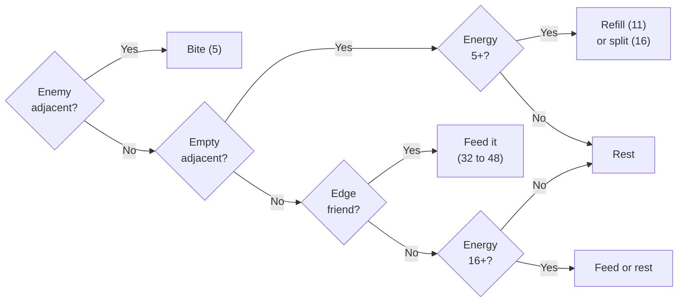

# Cell assembly: the instructions and the reasons for them

This document explains the x86-64 assembly in the CellHack2 cells: which instructions they use, why, and how each decision is coded. No prior assembly knowledge is required; see the [glossary](#glossary) for terms, [overview.md](overview.md) for game rules, and [cells-and-experiments.md](cells-and-experiments.md) for cell history.

## The short version

Each cell gets one turn per tick and returns one action. Cells running fewer instructions act earlier in the tick, which can win a contested square, so speed is the primary design goal.

To stay fast, the cells use a **one-step lookup**: copy part of the view into a 16-byte register, compare all 16 bytes with one instruction, pack the result into a bitmask, and index a lookup table for the action. Because the site only allows a subset of x86-64 instructions, each instruction set was probed before use.

The diagram shows how Schism, a mid-project cell, chooses one action (simplified), with instruction counts on each path. "Edge friend" means energy >= 6, no enemy in view, and a friend with an empty neighbour.



## Why instruction count matters

Within a tick, cells run in order of instruction count, lowest first. The count includes every instruction run, each taken jump and the final `ret`, the instruction that ends the call. All colonies share one pass per tick. The match seed orders equal counts, so a match with the same seed replays the same way (Rules, pages 2 and 3; Reference: "The engine counts every instruction."). A probe with a `mov` and a `ret` averaged 2 instructions per call on the site.

A call over 1000 instructions (`INSN_BUDGET` in `docs/cellhack.inc`) is a fault, and the cell does nothing that tick. The longest path in Covetous is 60 instructions, and in Scourge 53. The cap does not limit these cells.

A square freed by a death cannot be entered until the next tick. A square freed by a move can be entered later in the same tick. Two cells cannot swap places. So turn order in the next tick decides the race for a freed square. The total instruction count also breaks ties at the end of a match, after population and total energy (Rules, page 2).

## The core trick: one compare, one lookup

A register is a small storage slot in the processor. The cells use general registers such as `rax`. They also use the 16-byte registers `xmm0` to `xmm15`, which belong to the SSE instruction family.

The game passes a pointer to the view in `rdi`. The view holds 25 bytes, one per square of the 5 by 5 block, in row order. The cell is at index 12. Index 7 is up, 11 left, 13 right, 17 down. This is the bite from `cells/covetous.asm`, which every later cell reuses:

```nasm
start:
	movdqu		xmm0, [rdi + VIEW_CELLS + VIEW_UP]	; view idx 7..22
	pcmpeqb		xmm0, [kEnemy]
	pmovmskb	ecx, xmm0			; bits 0 UP, 4 LEFT, 6 RIGHT, 10 DOWN
	or		al, [abs bite_tbl + rcx]	; rax = 0 at entry: al = eat action, ZF = no enemy
	jnz		EXIT_ADDR			; bite: leave through the return address
```

1. `movdqu` copies 16 bytes from the view into `xmm0`. It works at any address (`u` = unaligned).
2. `pcmpeqb` compares 16 pairs of bytes. Equal bytes give 0xFF, others 0. `kEnemy` holds the enemy value 2 in the four neighbour positions and 0xFF elsewhere. No square has the value 0xFF, so those positions never match.
3. `pmovmskb` packs the top bit of each byte into `ecx`. This is the mask: bit 0 UP, bit 4 LEFT, bit 6 RIGHT, bit 10 DOWN.
4. `or al, [abs bite_tbl + rcx]` reads the table entry for the mask. `abs` fixes the table address when the file is built.

Example: mask 0x411 has bits 0, 4 and 10 set, so enemies stand UP, LEFT and DOWN. With three enemies, the rule is to bite the side opposite the free side, which is LEFT. The table entry is 0x33: 0x30 means bite, and 3 means LEFT.

The bite table has 1106 entries, one per mask value from 0 to 0x451. The generator fills every entry. A lookup costs one read, whichever squares hold enemies. A chain of if-statements would cost one compare and one jump for each case.

## The five-instruction bite

The five lines above form the bite: three build the mask, the fourth reads the answer, and the fifth exits if an enemy was found.

`or` sets the zero flag: a mask with no adjacent enemy reads a zero byte, keeping the zero flag set so execution falls through to the slow path below. A miss costs the same 5 instructions as a hit.

`jnz` jumps when the zero flag is clear to `EXIT_ADDR` (the return address), ending the call without a `ret` and saving one instruction.

The design notes call this F5: 5 instructions in every direction, with no memory. (Bane v2.1 adds a 4-instruction repeat bite using cell memory.) The strongest rivals bite in ~4 instructions in one fixed direction, ~6 in a second, and 8+ in the others, so F5 beats every rival's second direction and slower sides.

Four facts make the bite safe:

- The `or` needs `al` to be zero at entry. Probe `c_rax_probe` found `rax` zero on every call.
- The bite overwrites `xmm0` and `ecx` before it reads them. Probes `r_gpr_zero` and `q_xmm_zero` also found `rbx`, `rcx`, `rbp`, `r8` to `r15` and `xmm0` to `xmm15` zero at entry.
- The `jnz` exit needs the site to treat a jump to the return address like a `ret`. Probe `e_jexit` confirmed this: 2 instructions per call and no faults.
- The jump leaves the stack pointer 8 bytes lower than a `ret` does. This is safe because the game resets the stack before every call.

## Splitting, and the energy threshold

A split creates a child on an empty neighbouring square. The code uses the same pattern, with a constant that marks empty squares:

```nasm
split:
	movdqu		xmm0, [rdi + VIEW_CELLS + VIEW_UP]
	pcmpeqb		xmm0, [kEmpty]
	pmovmskb	eax, xmm0			; bits set = empty adjacent squares
	test		eax, eax
	jz		feed
	mov		al, [abs split_tbl + rax]	; non-zero mask -> a split
	ret
```

`test` sets the zero flag when the mask is zero, and `jz` then goes to the feeding code. Otherwise the table gives the split direction. The cell must have enough energy before this code runs. Covetous sets the threshold with a 5x5 check:

```nasm
	cmp		esi, SPLIT_MIN
	jb		rest
	movdqu		xmm1, [rdi + VIEW_CELLS]	; view idx 0..15
	movdqu		xmm2, [rdi + VIEW_CELLS + 9]	; view idx 9..24
	pcmpeqb		xmm1, [kTwoLo]			; lane 12 (self) never matches
	pcmpeqb		xmm2, [kTwoHi]			; lane 3 (self) never matches
	por		xmm1, xmm2
	pmovmskb	eax, xmm1
	test		eax, eax
	jnz		threat
```

`esi` holds the cell's energy. A cell below 5 energy rests. The 25 squares do not fit in one 16-byte window. So the cell uses two overlapping windows and joins them with `por`. The constants keep the cell's own square out of the result.

| Situation | Threshold | Reason |
|---|---|---|
| Ordinary play | 5 | `SPLIT_MIN` in `docs/cellhack.inc`. |
| Enemy anywhere in the 5x5 view | 16 | The prey rule: a child near an enemy must get at least 8 energy. |
| From tick 2980 | 5 | Endgame rule: fill every empty neighbour. |

## Feeding from full cells

Feeding gives 2 of the feeder's energy to the cell in the chosen direction. A feeder with less than 2 gives all it has, and dies if that was all. The target can be an enemy, so the cells check for a friend first. A cell near the cap of 50 gains little from resting, so giving energy away costs it little. In Covetous, a cell with 47 energy or more feeds its poorest friend neighbour, if that friend has 46 energy or less:

```nasm
feed:
	cmp		esi, 47
	jb		rest
	mov		r8d, 255			; poorest friend energy so far
	mov		eax, ACT_REST
	cmp		byte [rdi + VIEW_CELLS + 7], CELL_FRIEND	; up
	jne		.n_up
	movzx		ecx, byte [rdi + VIEW_ENERGIES + 7]
	cmp		ecx, r8d
	jae		.n_up
	mov		r8d, ecx
	mov		al, ACT_FEED + DIR_UP
```

`r8d` keeps the lowest friend energy so far. It starts at 255, so the first friend always wins. The block repeats for right, down and left. A target at 47 or more gains little. One rival, Aegis, wasted 34% of its feeds on full cells. The feeding floor is 16 energy in Scourge and 12 in Contagion.

## The refill gate in Scourge

A freed front square is an empty neighbour with an enemy beyond it or beside it. Scourge tries to retake these squares as soon as the bite finds no enemy:

```nasm
slow:						; 5 instructions so far
	movdqu		xmm1, [rdi + VIEW_CELLS + 6]	; view idx 6..21
	pcmpeqb		xmm1, [kRefill]			; empty neighbours, enemies beside/beyond them
	pmovmskb	ecx, xmm1			; mask 0..7607
	mov		al, [abs act_tbl + rcx]		; split to take (0 = no empty neighbour)
	cmp		sil, [abs thr_tbl + rcx]	; energy it needs (12 refill, 16 other, 255 boxed)
	jae		EXIT_ADDR			; refill / split: 11 instructions
```

The window starts at view index 6. `kRefill` marks the four neighbours as empty and six more squares (the diagonals and the squares two steps left and right) as enemies. The mask reaches 7607, so the table has 7,608 entries.

`act_tbl` gives the split direction for the mask. `thr_tbl` gives the energy that split needs: 12 for a refill, 16 for a normal split, 255 for a boxed cell (no empty neighbour), which can never split. `cmp sil` compares the energy with that number, and `jae` leaves when it is enough.

The path is 11 instructions: 5 for the bite and 6 lines above. Only the VEX variants reach 10, and they are broken on the site.

A parent with 12 energy gives its child 6. AtomPush's children were 5 to 7 energy in the replay study.

The window does not reach squares 2 and 22, the squares beyond UP and DOWN. Indexes 2 to 22 need 21 bytes. Reading them would cost at least 3 more instructions on the path that has to stay fast.

Scourge refilled 98% of the squares that its rivals ate from it in the ladder study.

## The prey hold, and why Complacency drops it

Covetous, Scourge and Contagion rest instead of splitting when they have 5 to 15 energy and an enemy is anywhere in the 5x5 view, until tick 2980. In Scourge and Contagion, a refill at 12 energy or more still splits. This is the Scourge code:

```nasm
threat:
	cmp		dword [rdi + VIEW_TICK], 2980
	jae		EXIT_ADDR			; late: split anyway
rest:
	mov		al, ACT_REST
	ret
```

Scourge lost the land grab. At tick 200 it had about 800 cells on the ladder, and the winners had about 2400. Complacency is Scourge with the hold removed. Its middle split is a plain split at 5 energy or more, with no 5x5 check. That path costs 16 instructions. Scourge's same paths cost 24 to 27:

```nasm
	cmp		esi, 5
	jb		rest
	ret					; split: no prey hold
rest:
	mov		al, ACT_REST
	ret
```

The simulator sweep tested a hold that stops at tick 200, 300, 500 or never, and a hold only for a diagonal enemy. "Never" gave the highest final population in all three mixes, with equal win rates, and it is the simplest code. In head-to-head runs on new seeds, the start slot decided the result, not the cell.

Pull 5 shows that dropping the hold did not close the grab gap: Complacency reaches 128 and 512 cells at t36 and t84, versus t29 and t63 for AtomPush. The gap opens in the first 35 ticks; [designs.md](../docs/archive/designs.md) 10.2 initially blamed split direction, and solo growth runs ([designs.md](../docs/archive/designs.md) 11.1) showed feeding gives most of the gain, which Schism tested on the ladder.

## Constraints and what was ruled out

The site runs a limited set of instructions. Probe cells in `cells/calib/` tested each set:

| Instruction or set | Result on the site | Probe |
|---|---|---|
| SSE2 basics, such as `movdqu`, `pcmpeqb`, `pmovmskb`, `por` and `pxor` | Works, and the cells use them | Used in the cells |
| `popcnt` | Invalid-instruction fault on every call | `f_popcnt` |
| `pshufb` (SSSE3) | Not supported | `g_ssse3` |
| `ptest` (SSE4.1) | Not supported | `h_sse41` |
| `crc32` (SSE4.2) | Not supported | `m_sse42` |
| `andn` (BMI1) | Not supported | `i_bmi1` |
| `pext` (BMI2) | Not supported | `j_bmi2` |
| 256-bit AVX2 (`ymm` registers) | Not supported | `l_avx2` |
| VEX `vpshufb` | Not supported | `n_vex_pshufb` |
| VEX `vptest` | Not supported | `o_vex_ptest` |
| 128-bit VEX `vpcmpeqb` | Works | `k_avx` |
| VEX `vpcmpeqb` with an unaligned memory operand | Works | `p_vex_unaligned` |

VEX is a newer encoding that can name three registers. The VEX forms that work are the 128-bit forms of SSE2 operations. The cells use only SSE2. The site's processor is plain `qemu64`. The Reference says that SSE2 and SSE3 are available and that anything newer is not guaranteed. It bans `syscall`, `sysenter`, `int`, `int3`, `ud2`, `in`, `out` and `rdrand`. `rdtsc` works and returns the tick.

Probe `s_vex_src` showed that a VEX compare reads its destination, not its first source. Unicorn has the same bug. `cells/vex_emu.py` runs that instruction the way the site does. Woe, Conceit and Endemic are VEX variants of Scourge, Covetous and Contagion. They are broken on the site and must not be submitted.

Legacy SSE instructions that read memory need an address that is a multiple of 16, so each constant has `align 16`. The view window can start at any byte, so the cells load it with `movdqu`.

The cells use no loops and no stack. Only Contagion (on its scout path) and Bane v2 use the cell memory. Bane v2 uses it for its dispersal opening and, from v2.1, for its stored bite. These are project speed rules, not game rules. The Reference allows mutable data in the cell memory (`[rdx]`) or on the stack, and the Quick start says "The stack is yours." The Reference names two hazards: writes to the code or view pages, and running off the stack.

## How the cells were checked

`cells/check_cells.py` runs NASM, static checks, and, with Unicorn, a comparison with the Python reference ([cells-and-experiments.md](cells-and-experiments.md) has the details). Complacency was compared on 200,512 cases with no mismatches.

Passing the checker does not show that a cell works on the site, so the last check is the Sandbox: up to three opponents, 16 by 16, 500 ticks. Each match page shows the average and maximum instructions per call and a fault log. Complacency's two Sandbox games had no faults, with an average of 39 instructions per call and a maximum of 53. The simulator is a separate, approximate check: [simulator.md](simulator.md).

## Contagion additions

Contagion is Scourge with a feeding floor of 12 and two additions:

- **Grab assist.** A donor with no empty neighbour and 8 or more energy feeds a poor friend with 4 or less, when that friend has room to grow and no enemy is in view.
- **Scouts.** A start cell within 10 squares of an edge splits a scout child. A scout moves along its bearing at most 10 times, and stores its origin and steps in the cell memory.

## Misfortune additions

Misfortune v1 (`cells/gen_misfortune.py`, Cap B, exact 1) is Bane v2.2 with a blind bite indexed by energy. Its reference is `make_misfortune(cap='B', exact=1)` in `sim/cells_ref.py`.

- **Armed bite.** `or al, [esi + CELLMEM_BASE + 13]` and `jnz EXIT_ADDR`: 2 instructions. Byte 13 + e holds the bite to play at energy e. The access uses `esi` (address-size prefix 0x67), not `rsi`.
- **Prefix.** Every other path first zeroes the 16 bytes at 9 + e0 with `xmm0` (zero at entry). Byte 8 holds e0, the energy at the last arming. Slow paths cost 4 more instructions than the core of Bane v2.2.
- **Arming.** A bite found by the view scan writes byte 8 and one 16-byte pattern row (direction, k) at 9 + e0. This takes 19 instructions. k is the number of bites that an unfed target still needs, at most 5.
- **Cap B rule.** A boxed cell tests its edge friends without branches: two SSE compares for the ring squares, then table lookups. A hit takes exactly 80 instructions. A miss takes exactly 56. Filler instructions (`xor r11d, r11d`) make both counts equal to the reference's counts.

The checker compares the assembly with the reference on energies 0 to 50, random memory and random views. It also compares them on every empty, friend and enemy pattern of the 8 squares around the edge friends.

## Misfortune v2 additions

Misfortune v2 (AC1, cell 352) was Misfortune v1 plus a checked refill, armed children, no prey hold and a feed pad. It failed on the ladder (1326 after 9 games). This section describes the first v2 build, the checked-refill build (commit 44e50da). Its reference is `make_misfortune2_m2v0` in `sim/cells_ref.py`. After the failure, `cells/gen_misfortune2.py` and `cells/misfortune2.asm` were rebuilt as the live cell 353 (next section). The v1 files stay as they are.

- **Checked refill.** Each bite stores one word at memory byte 2. The word holds SPLIT plus the direction, and the view offset of the bitten square. It comes from the same table lookup as the pattern row (`row4_tbl`, one dword per target energy and direction), so the biting path pays one extra instruction. On every slow path, right after the prefix, the cell reads byte 2. If byte 2 is set, the square in the view is empty and the cell has 12 or more energy, the cell splits into that square at once (13 instructions). Every path clears byte 2 first, so a child starts clean. If the stored square is taken or the cell is too weak, a copy of the bite scan runs next, so a bite does not pay a clear store.
- **Split hold.** Before, an enemy on a diagonal square held a cell of 5 or more energy. In v2, a cell with 10 or more energy splits at once (`threat:` tests `esi` against 10). Below 10 energy the old hold applies and costs 2 more instructions.
- **Counts.** Armed bite: 2. First bite: 22. Bite after a stored direction: 26 (square taken) or 28 (energy below 12). Other slow paths: 2 more than v1. A clear without a bite: 8 or 10 more. Cap rule: 80 when nothing is stored.

The checker (`--only misfortune2`) uses the same method as for v1. It adds a sweep over every stored direction, square occupant and energy.

## Misfortune v3 (the live cell 353)

Misfortune v3 is Misfortune v1 plus one change: the split hold. It is built by `cells/gen_misfortune2.py` into `cells/misfortune2.asm`. The reference is `make_misfortune2_split10` in `sim/cells_ref.py`, which is `make_misfortune(cap='B', exact=1, hold='split', hold_min=10)`.

- **Split hold.** From 10 energy the cell splits at once, even with an enemy on a diagonal square. Below 10 the old hold applies.
- **Counts.** It keeps the 19-instruction first bite, the 15-instruction Gate 1 and the 2-instruction armed bite of v1. The binary has 23,674 bytes.
- **Check.** Unicorn: 59,058 cases, 0 mismatches (58,991 after a harness fix that changed only the random view stream).

## Depravity additions

Depravity (`cells/gen_depravity.py`, cell 363) was a clean-sheet cell. The list below describes the build that played on the ladder (commit 6cfb4a7). Its binary has 18,602 bytes. The generator in the repository now builds the hotfix (see Result): it has Cap B and no feeding gate, and its binary has 23,610 bytes.

- **Table jump for the arm step.** `jmp [arm_tbl + rax*8]` goes to one of four stubs. The arm step costs 17 instructions, not 19.
- **No Cap B.** The boxed cell has no rule that drains rear friends from 48 to 46 energy. A feeding gate (`T_FEED = 200`) stopped boxed cells from feeding before tick 200.
- **First moves.** The opening walker (8 squares, then 2) picks its direction with SSE2 and a 256-byte table, with no `popcnt`. The prey hold starts at 8 energy.
- **Check.** `check_cells --only depravity`: 38,960 cases, 0 mismatches, one planted mutation caught.
- **Result.** It failed on the ladder. The external reviewer blamed the missing Cap B and the feeding gate. The hotfix e729e16 restored Cap B. The project built and checked the hotfix locally (38,960 cases, 0 mismatches) and never uploaded it.

## Dogma additions

Dogma (`cells/gen_dogma.py`, `cells/dogma.asm`) was the last build. The binary has 20,682 bytes. The project never uploaded it.

- **Counter bite.** A 3-instruction bite that answers a stun on a blind tick. The stun still shifts the stored bite mask by one.
- **Walker opening.** The first child goes 8 squares, later ones 2.
- **Rotating pick.** The +2 lanes are chosen from 256-byte tables (`open_lo`, `open_hi`) with a 4-byte `d2_tbl` and a 1,024-byte `dir_pick_tbl`.
- **Check.** `check_cells --only dogma` passes. `cells/test_dogma.py` ran 49,023 Unicorn checks with 0 failures, and it caught 8 of 8 planted mutants. Every instruction count met its spec.
- **Result.** On our own engine it did not beat Misfortune v3, because its 3-instruction bite lost to the 2-instruction bite of v3. See [final-round-2026-11-13-14.md](../docs/archive/reviews/final-round-2026-11-13-14.md), section 5.

## Known limitations

- The checker cannot show that a cell works on the site. Only the Sandbox and the ladder can.
- The VEX cells (Woe, Conceit, Endemic) are broken on the site and were never submitted.
- Dogma and the Depravity hotfix were never on the ladder. Their counts are exact, and their results come from the local engine.

## Glossary

| Term | Plain meaning |
|---|---|
| Action byte | The one-byte answer a cell returns in `al`. It says what the cell does, such as rest, bite or split. |
| Branch or jump | An instruction that moves the processor to another place in the code. A jump is taken when it moves. |
| Constant | A fixed value stored in the cell file, such as `kEnemy`. |
| Emulator | A program that runs machine code in software. Unicorn is the emulator that the checker uses. |
| Flag | A single bit that the processor sets after some instructions. The zero flag is set when the result is zero. |
| Instruction | One step the processor performs, such as copy, compare or jump. |
| Instruction count | The number of instructions a cell runs in one turn. |
| Lane | One byte position inside a 16-byte register. |
| Lookup table | A list in memory. The cell reads one entry from it, using an index, to get the answer. |
| Mask | A number whose bits each answer one yes-or-no question, such as whether a square has an enemy. |
| NASM | The assembler that turns the cell's source text into machine code. |
| Register | A small storage slot inside the processor. The cell's register names include `rax`, `ecx` and `xmm0`. |
| Return address | The place in the game that a cell's call returns to. A `ret` goes there. |
| SIMD | Single instruction, multiple data. One instruction works on several values at once. |
| SSE and SSE2 | SSE is a family of SIMD instructions for 128-bit registers. SSE2 is its second set, which the cells use. |
| Taken jump | A jump that actually moves the processor. It counts as an instruction. |
| VEX | A newer way to encode SSE-style instructions. It can name three registers. The site runs the VEX compare with the wrong source, so the cells do not use it. |
| View | The cell's 5 by 5 block of squares, which the game passes in memory. |
| Window | A 16-byte slice of the view, read into one register. |
