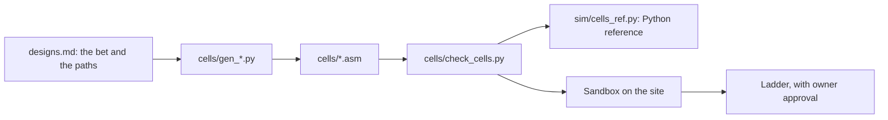
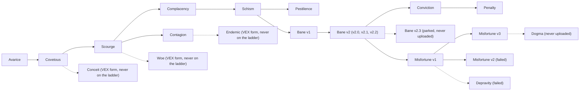

# Cells, calibration probes and experiments

This document explains how cells are designed, generated and checked. It also lists the calibration probes, the simulator experiments, the history of each cell and the final ladder status. No further work is planned. Terms such as cell, bet, tick and ladder are defined in [overview.md](overview.md). The instructions themselves are explained in [cell-assembly.md](cell-assembly.md).

## From design to ladder

## How cells are generated

Each cell has a generator, `cells/gen_<name>.py`, that writes `cells/<name>.asm`. The generator builds the code and every table, so each rule changes in one place. The lookup method is in [cell-assembly.md](cell-assembly.md).

Code rules (`designs.md` 2.7):

- SSE constants are aligned to 16 bytes. Unaligned windows use `movdqu`.
- Every table entry is filled.
- No `org`, `bits`, `section` or `%include` lines. The site adds its own header.
- No loops, no stack and no writes to the cell memory on the hot paths. These are project speed rules. The game allows all three (Reference, pages 1 and 2).
- The cell is built for interface version 4 (`ABI_VERSION` in `docs/cellhack.inc`).

## Instruction counts

The count includes every executed instruction, taken jumps and the final `ret` (Reference, page 3). The header of each `.asm` file lists the count of each path.

| Path | Instructions | Cell |
|---|---|---|
| Bite, every direction | 6 | Avarice |
| Bite, every direction, no memory (a miss costs the same) | 5 | Covetous, Scourge, Contagion, Complacency, Schism |
| Refill, or split at energy 16 or more | 11 | Scourge, Contagion, Complacency, Schism |
| Repeat bite on the square bitten last time (stored in the cell memory) | 4 | Bane v2.1 |
| Split at energy 5 to 15 | 24 or 25 (hold: rest at 27) | Scourge |
| Split at energy 5 to 15, never hold | 16 | Complacency, Schism |
| Boxed feed to a friend with an empty neighbour | 32 to 48 | Schism |
| Split path | 19 to 23 | Avarice |
| Armed bite (the bite is stored in advance) | 2 | Misfortune, Depravity |
| First bite of Misfortune (the arming step) | 19 (Depravity: 17) | Misfortune v1 and v3, Depravity |
| Queued bite | 3 | Conviction, Penalty |
| Counter bite | 3 | Dogma |
| Gate 1 (refill or split at energy 16 or more) | 15 | Misfortune, Depravity, Dogma |

## The checker

`cells/check_cells.py` runs from the repository root in a Linux shell (WSL on Windows). It needs NASM. The Unicorn emulator is optional. Without it, only the static checks run.

- **Static checks.** Source under 64 KB, binary under the size limit, no forbidden directives, tables hold only valid actions, table entries point to valid labels, instructions on the allowed list.
- **Emulator comparison.** Unicorn runs each cell and its Python reference (`sim/cells_ref.py`) on the same inputs. The results must match.
- **Calibration probes.** With Unicorn, it reports the instruction count of each probe in `cells/calib/`.
- **Result.** `ALL CHECKS PASSED`, or a count of problems and the failing cells. The shelved VEX cells Woe, Conceit and Endemic always fail. They are expected failures, and the run then ends with `ALL OTHER CHECKS PASSED`. The exit code is 1 only when another cell fails.

The allowed list matters because Unicorn runs instructions that the site rejects, such as `popcnt`.

### The VEX helper

Unicorn 2.1.4 ignores the first source register of a VEX `vpcmpeqb`. The site has the same bug. `cells/vex_emu.py` runs that one instruction with the site's behaviour, and raises an error on any other VEX instruction. The checker rejects a VEX instruction whose destination is not its first source.

## Calibration probes

A probe is a small cell that answers one question about the game. The site's match page shows its average and maximum instructions per call and a fault log. The site form puts a cell on the ladder at once. A scripted request saves a cell without that. `a_rest` played one ladder game by accident. A scripted request saved every other probe.

| Probe | Question | Result on the site |
|---|---|---|
| `a_rest` | Does `ret` count? | Yes. Average 2 (2). |
| `b_jmp` | Does a taken jump count? | Not run. `e_jexit` shows that it does: `mov` and a taken `jmp` averaged 2. |
| `c_rax_probe` | Is `rax` zero at entry? | Yes, every call. Average 4 (4), no faults. |
| `d_rep_probe` | Does `rep stosb` count once or per byte? | Per iteration. 100 iterations gave 105. |
| `e_jexit` | Can a call end with a jump to the exit address? | Yes. Average 2 (2); the cell grew to 50 energy. |
| `f_popcnt` | `popcnt` | No. Invalid-instruction fault on every call. |
| `g_ssse3` | `pshufb` (SSSE3) | No. |
| `h_sse41` | `ptest` (SSE4.1) | No. |
| `i_bmi1` | `andn` (BMI1) | No. |
| `j_bmi2` | `pext` (BMI2) | No. |
| `k_avx` | 128-bit VEX `vpcmpeqb` | Yes. Average 3 (3), no faults. |
| `l_avx2` | 256-bit AVX2 (`ymm`) | No. |
| `m_sse42` | `crc32` (SSE4.2) | No. |
| `n_vex_pshufb` | VEX `vpshufb` | No. |
| `o_vex_ptest` | VEX `vptest` | No. |
| `p_vex_unaligned` | VEX with an unaligned memory operand | Yes. Average 3 (3), no faults. |
| `q_xmm_zero` | `xmm0` to `xmm15` zero at entry? | Yes. Average 22 (22), no faults. |
| `r_gpr_zero` | `rbx`, `rcx`, `rbp`, `r8` to `r15` zero at entry? | Yes. Average 15 (15), no faults. |
| `s_vex_src` | Does a VEX compare use its first source or its destination? | The destination. Bad-action fault on every call. |
| `t_failed_eat` | Does a failed action earn the +1 of a rest? | No. Energy stayed at 10 for 500 ticks. |

## Experiments in the simulator

The batch sets and the accuracy limits are in [simulator.md](simulator.md).

- **Complacency sweep (136 games).** The prey hold stopped at tick 200, 300, 500 or never. One version held only for a diagonal enemy. Never-hold had the highest final population in all three mixes. Win rates were equal.
- **Complacency on new seeds.** On seeds 9 to 16, a head-to-head mix gave Scourge 2.50 points (75%) and Complacency 1.75 (12%). In a mirror run, the winner followed the start slot, not the cell. These numbers are start luck.
- **VEX cells.** Their figures assumed the documented three-operand form. The site does not run that form, so the figures do not describe the site.
- **Solo growth (Schism).** `sim/growth.py` compares split-direction rules for a colony alone. The study is finished; the chosen rule is in `designs.md` 11.1.

## Cell lineage

A solid arrow means "built from". A dotted arrow means a looser link: a VEX form of the same decisions, a parked or failed side branch, or a new design that took ideas from its source. Every cell in the final status table below appears here, and so does the parked Bane v2.3.

| Cell | Bet | What it does | What it taught |
|---|---|---|---|
| Avarice (site cell 149; named Sprint until 2026-11-08, and code and stored match data keep that name) | None: the first ladder cell. | Bites in 6 in every direction. Eats greedily. Never feeds. | Lost races for freed squares to the Atom cells: won 0.5% of 27,339 races against AtomPush and 3.6% of 6,915 against AtomCrasher. Median refill child 25 energy; Atom cells 6. |
| Covetous (155) | A faster bite is enough. | Bites in 5, no memory. Feeds from capped cells. Prey hold. | 60.4% wins in its first 217 games. |
| Scourge (156) | Kills convert into land. | Covetous, plus a refill gate (11 instructions, child at least 6 energy), plus feeding from 16. | Won 74 of its newest 100 games. Refilled 98% of the squares rivals ate from it. Lost the early land grab. |
| Contagion (157) | The grab decides. | Scourge, plus a grab assist, scouts, and feeding from 12. | 70 of its first 95 games won (74%). Ahead early, behind at t75 to t200. Scouts barely used, about 6 moves per replay. |
| Complacency (174) | Dropping the prey hold helps. | Scourge with no prey hold (never hold). | Sandbox: 1st with 88 cells (Scourge 82), 2nd with 94 (Scourge 162), no faults. Pull 5: still trails the Atom cells in the first 35 ticks (`designs.md` 10.2). |
| Schism (176) | Feeding the growing edge wins the grab. | Complacency, plus: no enemy in the 5x5, boxed, energy at least 6: feed the first friend with an empty neighbour. | Sandbox, 3 games each against Scourge, Covetous, Contagion: places 2, 1, 2 (Complacency 2, 2, 3), 0 faults, no seed control. Path counts: `designs.md` 11.1. |
| Pestilence (180) | Moving strong cells forward beats splitting a weak child. | Schism, plus: on the refill path with energy at least 20, move into the freed square instead of splitting (`designs.md` 11.2, change 1 only). | Sandbox 2nd, 0 faults. Ladder: 2nd with 1576 after 377 games (2026-11-10), average place 1.24 against Schism's 1.23. |
| Bane (built 2026-11-10, `cells/gen_bane.py`) | Children born next to a faster biter die before they act; the prey hold saves them. | Schism with Scourge's prey hold back: with an enemy in the 5x5, a cell at 5 to 15 energy rests instead of splitting. Bite, refill and feeding unchanged. | From replays 123880 and 123990 (`docs/evidence/contact-study-2026-11-10.md`): the new rivals bite as fast as we do, so our border cells are stunned about half the time; in the t100-200 grab Schism lost 118 cells, Ironbloom 3. Bane v1 reached about 1300 after 44 games (10th) on the ladder and is retired. |
| Bane v2 (`cells/gen_bane2.py`; v2.0, v2.1 and v2.2) | Spread-out colonies are not boxed in. A fixed bite target is faster than a view scan. | Bane v1, plus a dispersal opening. With an empty neighbour and no enemy near, children walk away before they settle (the first child 8 squares forward, later ones 2 squares). This uses the cell memory and MOVE. v2.1 adds a stored bite: if an enemy is still there, the cell bites the square it bit last time, in 4 instructions. v2.2 holds back only with an enemy on a diagonal square, not anywhere in the 5x5. | v2.0 was retired at 1645 after 157 games, in 1st place. v2.1 reached 1775 after 189 games (1804 after 203 at its last read), with 175 wins, average place 1.07 and 1st place, 189 points ahead of Colossus. In replays it eliminated medivac, and it lost to CogSpore twice and to Colossus once. v2.2 (shown on the site as Bane v4) played one Sandbox game with 0 faults. It replaced v2.1 on the ladder on 2026-11-11 at 15:05 UTC. Its last read, on 2026-11-13: 1761 after 1883 games, average place 1.15, 2nd. Details: `designs.md` 11.3. |
| Conviction (`cells/gen_conviction.py`) | Acting on last tick's belief makes the bite faster. | Bane v2.2 with a bite queue: after one look, it bites the same square for several ticks in 3 instructions. | 1635 after 155 games. Bitten first far less often than Bane v2.2, but it refilled few of the squares it freed. |
| Penalty (`cells/gen_penalty.py`) | The queue should end with a split into the dying target's square. | Conviction plus that split. | A test cell. No result was kept. |
| Misfortune v1 (350; `cells/gen_misfortune.py`) | A 2-instruction bite is the floor, so an armed cell bites before every cell we know. | After one look, it stores its next bites by its own energy. Each later bite takes 2 instructions. | Sandbox 1st, 0 faults. Ladder: 1751 after 172 games, 2nd. |
| Misfortune v2 = AC1 (352; commit b40b1a4, its generator was later rewritten for v3) | A checked refill and armed children add to v1. | v1 plus a checked refill, armed children, no prey hold and a feed pad. | Failed: 1326 after 9 games. A slower first bite and more friendly bites. |
| Misfortune v3 = split10 (353; `cells/gen_misfortune2.py`) | The v2 fix: go back to v1 and change one thing. | v1 plus: cells with 10 or more energy split even with an enemy near. | Live to the end: 1841 after 441 games, average place 1.17, 3rd. |
| Depravity (363; `cells/gen_depravity.py`) | Without Cap B, a clean-sheet cell with a 17-instruction arm step wins the front. | Table jump for the arm step, no Cap B, no feeding of boxed cells before tick 200. | Failed in its first 5 games: 1193. |
| Dogma (`cells/gen_dogma.py`) | A 3-instruction counter bite with a walker opening beats the 2-instruction bite. | Counter bite, first 8/2 walker, +2-lane pick. | Met its spec. Did not beat Misfortune v3 locally. NO-GO, never uploaded. |
| Woe, Conceit, Endemic | Same decisions, fewer instructions. | VEX forms of Scourge, Covetous and Contagion. | Never on the ladder. Woe died in two Sandbox games (peaks 4 and 5 cells). Broken on the site; do not submit. |

### Final ladder status

This table lists every cell that played on the ladder, with the last figure the project recorded. The ladder log (`data/site-checks.md`) is local only. Editing a cell on the site creates a new cell id, so each version has its own number and its own rating ([site-observations-2026-11-08.md](../docs/evidence/site-observations-2026-11-08.md)). A new version starts at rating 1000. The places for Avarice to Contagion and Complacency are from site reads on 2026-11-10. The Schism, Pestilence and Bane places are from the My cells page on 2026-11-11 to 2026-11-13.

| Cell (site id) | Last recorded state | Rating, games | Last recorded place |
|---|---|---|---|
| Avarice | Retired 2026-11-08. | 1191, 886 | 9th |
| Covetous | Retired 2026-11-08. | 1392, 829 | 7th |
| Scourge | Retired 2026-11-08. | 1507, 600 | 2nd |
| Complacency | Taken off by the owner 2026-11-08. | 1516, 691 | 2nd |
| Contagion | Taken off by the owner 2026-11-09. | 1616, 2145 | 2nd |
| Schism | Retired 2026-11-11. | 1314, 2814 | peak 1675 on 2026-11-09 |
| Pestilence | Taken off 2026-11-11 to free a slot for test cells. | 1250, 1649 | peak 2nd |
| Bane v1 | Retired. | 1307, 44 | 10th |
| Bane v2.0 | Retired 2026-11-11. | 1645, 157 | 1st |
| Bane v2.1 | Replaced by v2.2 on 2026-11-11. | 1804, 203 | 1st |
| Bane v2.2 (shown on the site as Bane v4) | Taken off 2026-11-13 for Misfortune v1. Last read 2026-11-13. | 1761, 1883 | 2nd |
| Conviction | Last recorded 2026-11-11. No later figure was kept. | 1635, 155 | 3rd |
| Penalty | Tester cell. No result was kept. | none | none |
| Misfortune v1 (350) | Replaced by v2 on 2026-11-14. | 1751, 172 | 2nd |
| Misfortune v2 = AC1 (352) | Retired. It failed. | 1326, 9 | none |
| **Misfortune v3 = split10 (353)** | **Live at the last check, 2026-11-14 16:47.** | **1841, 441; average place 1.17** | **3rd** |
| Depravity (363) | Put on the ladder 2026-11-14, retired after 5 games. The hotfix d1637f3 was built and never uploaded. | 1193, 5 | none |
| Dogma | Built and checked. Verdict NO-GO. Never uploaded. | none | none |

At the last check the top of the ladder was: Siect-F 2053 (average place 1.05), then Misfortune v3 at 1841. The gap to first place was 212 points. The best ever place of a cell of ours was 1st (Scourge, Contagion, Complacency, Schism, Bane v2.0 and v2.1, at various times). None held it at the last check. Misfortune v3 was the last cell, and it held second or third place on 2026-11-14.

Win rates are a rough guide. The design notes say that direction luck is worth about 16 points of win rate. They ask for at least 50 games before the project judges a cell.

### The last cells, in short

**Conviction and Penalty (2026-11-11).** Conviction (`cells/gen_conviction.py`) is Bane v2.2 with a bite queue. After a bite found by the view scan, it stores several bites of the same square and plays one per tick in 3 instructions, without reading the view. It was bitten first in 7 to 23% of front ticks, where Bane v2.2 was bitten first in 40 to 88% by the same rival. But it filled only 10% of the enemy squares freed beside it (Bane v2.2: 60%). Penalty (`cells/gen_penalty.py`) was the test of a fix: when the target is expected to die, the queue ends with a split into its square.

**Bane v2.3 (2026-11-12 and 2026-11-13, parked).** `cells/gen_bane3.py` is Bane v2.2 with a cheaper first bite: 12 instructions, not 16 (`check_cells`: 931,437 cases, 0 mismatches). A new site version restarts the rating, and this gain was too small to show in wins. So the project held it for a bigger change. The bundle plan is in [v23-brief-2026-11-13.md](../briefs/v23-brief-2026-11-13.md). Misfortune replaced it.

**Misfortune v1 (2026-11-13, cell 350; `cells/gen_misfortune.py`).** A bite that does not look. After one look at an enemy beside it, the cell stores its next bites, chosen by its own energy. Each later bite takes 2 instructions, the fewest the game allows. The name fits because whoever bites it is bitten first on the next tick. Sandbox 146370: 1st, 0 faults. On the ladder it reached 1751 after 172 games.

**Misfortune v2 = AC1 (cell 352; commit b40b1a4).** Misfortune v1 plus a checked refill, armed children, no prey hold and a feed pad. It went live on the owner's go before the evidence was complete, and it failed: 1326 after 9 games. The checked refill made the first bite slower (19 to 22 instructions or more). It also raised the number of friendly bites. Details are in [misfortune2-audit-2026-11-13.md](../reviews/misfortune2-audit-2026-11-13.md) and [final-round-2026-11-13-14.md](../reviews/final-round-2026-11-13-14.md).

**Misfortune v3 = split10 (cell 353).** The emergency fix: Misfortune v1 plus one change. Cells with 10 or more energy split even with an enemy near (`hold='split'`, `hold_min=10`). It restored the 19-instruction first bite and the 15-instruction Gate 1 of v1. Unicorn check: 59,058 cases, 0 mismatches. It stayed on the ladder to the end.

**Depravity (cell 363; `cells/gen_depravity.py`).** A clean-sheet cell that dropped Cap B and used a table jump for the arm step (arm 17 instructions). In a Sandbox game it came 1st. On the ladder it failed in its first games: it could not push AtomVirus or VarSi back. The external reviewer blamed two causes: a 48/50 energy stalemate on front cells without Cap B, and a feeding gate (`T_FEED = 200`) that starved the front. The hotfix d1637f3 restored Cap B. The local check showed that it did not change the front cell, so the owner decided not to upload it. The live build is commit c4d7350. `cells/gen_depravity.py` and `cells/depravity.asm` in the repository are the hotfix.

**Dogma (`cells/gen_dogma.py`).** The last build: a 3-instruction counter bite, a first 8/2 walker and a rotating pick of the +2 lanes. It met every count of its spec, passed 49,023 Unicorn checks, and caught 8 of 8 planted mutants. It fixed what it was made for (no feeding before tick 100, no faults). But on our own engine it did not beat Misfortune v3, because its 3-instruction bite lost to the 2-instruction bite. Verdict NO-GO: it was never uploaded. The evidence is in [final-round-2026-11-13-14.md](../reviews/final-round-2026-11-13-14.md), section 5.

## Lessons that held up

- A faster first bite decided the front. A 2-instruction bite beat every rival bite we met.
- Contact was won, but growth was lost against Siect-F. Misfortune won the bite order at the front 89% to 11% in the game that was studied, and it lost the equal-area growth race.
- Local engine results did not predict ladder results for new designs. The rival models were not good enough to judge a cell. Treat a local win as a sign, not as proof.
- A live loss in the Sandbox against the previous version is a stop signal.
- Check a change against the live version in paired, slot-balanced games, never against a control that already carries the change under test.
- A new upload restarts the rating, so each upload costs time. A small gain is not worth one.

## Known limitations

- Conviction and Penalty have no final result in the repo.
- The site name (Bane v4) differs from the project name (Bane v2.2). The match rests on project notes from the time, not on the site. The evidence pack calls cell 289 Bane v2.2. The site shows cell 289 as "Bane v4". The site versions are 272 (v1), 277 (v2), 287 (v3, Bane v2.1) and 289 (v4). The site does not state the project version.
- Dogma and the Depravity hotfix are untested on the ladder. All claims about them come from the local engine.
- The Depravity root cause is the external reviewer's analysis. It was not verified on the ladder.

## Related documents

- [designs.md](../designs.md): facts, cell designs and decisions, with reasons.
- [scourge-losses-2026-11-08.md](../docs/evidence/scourge-losses-2026-11-08.md) and [contact-study-2026-11-10.md](../docs/evidence/contact-study-2026-11-10.md): loss studies.
- [bane-v22-evidence-2026-11-12.md](../docs/evidence/bane-v22-evidence-2026-11-12.md): the measures on Bane v2.2.
- [final-round-2026-11-13-14.md](../reviews/final-round-2026-11-13-14.md): the last round.
- [data-pulls.md](data-pulls.md): where the replay data came from. The local studies `data/contagion-games-2026-11-08.md` and `data/replay-mining-2026-11-08.md` (refill race numbers) are not in the repo.
- [simulator.md](simulator.md): how the simulator models these cells.
