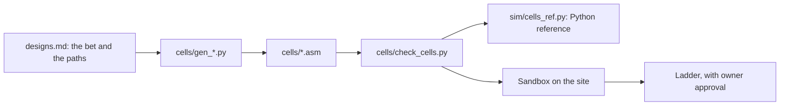
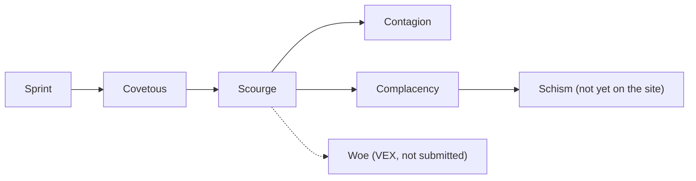

# Cells, calibration probes and experiments

This document explains how cells are designed, generated and checked. It also lists the calibration probes, the simulator experiments and the history of each cell. Terms such as cell, bet, tick and ladder are defined in [overview.md](overview.md). The instructions themselves are explained in [cell-assembly.md](cell-assembly.md).

## From design to ladder

## How cells are generated

Each cell has a generator, `cells/gen_<name>.py`, that writes `cells/<name>.asm`. The generator builds the code and every table, so a rule changes in one place. The lookup method is in [cell-assembly.md](cell-assembly.md).

Code rules (`designs.md` 2.7):

- SSE constants are aligned to 16 bytes. Unaligned windows use `movdqu`.
- Every table entry is filled.
- No `org`, `bits`, `section` or `%include` lines. The site adds its own header.
- No loops, no stack and no writes to the cell memory on the hot paths. These are project speed rules. The game allows all three (Reference, pages 1 and 2).
- The cell is built for interface version 4 (`ABI_VERSION` in `docs/cellhack.inc`).

## Instruction counts

The count includes every executed instruction, taken jumps and the final `ret` (Reference, page 3). The header of each `.asm` file lists the count of each path.

| Path | Instructions | Cell |
|---|---|---|
| Bite, every direction | 6 | Sprint |
| Bite, every direction, no memory (a miss costs the same) | 5 | Covetous, Scourge, Contagion, Complacency |
| Refill, or split at energy 16 or more | 11 | Scourge, Complacency |
| Split at energy 5 to 15 | 24 or 25 (hold: rest at 27) | Scourge |
| Split at energy 5 to 15, never hold | 16 | Complacency, Schism |
| Boxed feed to a friend with an empty neighbour | 32 to 48 | Schism |
| Split path | 19 to 21 | Sprint |

## The checker

`cells/check_cells.py` runs from the repository root in a Linux shell (WSL on Windows). It needs NASM. The Unicorn emulator is optional. Without it, only the static checks run.

- **Static checks.** Source under 64 KB, binary under the size limit, no forbidden directives, tables hold only valid actions, table entries point to valid labels, instructions on the allowed list.
- **Emulator comparison.** Unicorn runs each cell and its Python reference (`sim/cells_ref.py`) on the same inputs. The results must match.
- **Calibration probes.** With Unicorn, it reports the instruction count of each probe in `cells/calib/`.
- **Result.** `ALL CHECKS PASSED`, or a count of problems and the failing cells. The shelved VEX cells Woe, Conceit and Endemic always fail. They are expected failures, and the run then ends with `ALL OTHER CHECKS PASSED`. The exit code is 1 only when another cell fails.

The allowed list matters because Unicorn runs instructions that the site rejects, such as `popcnt`.

### The VEX helper

Unicorn 2.1.4 ignores the first source register of a VEX `vpcmpeqb`. The site has the same bug. `cells/vex_emu.py` runs that one instruction with the site's behaviour, and raises an error on any other VEX instruction. The checker rejects a VEX instruction whose destination is not its first source.

## Calibration probes

A probe is a small cell that answers one question about the game. The site's match page shows its average and maximum instructions per call and a fault log. The site form puts a cell on the ladder at once. A scripted request saves it without that. `a_rest` played one ladder game by accident. All other probe uploads were saved by scripted request.

| Probe | Question | Result on the site |
|---|---|---|
| `a_rest` | Does `ret` count? | Yes. Average 2 (2). |
| `b_jmp` | Does a taken jump count? | Not run. The Reference says every instruction counts. |
| `c_rax_probe` | Is `rax` zero at entry? | Yes, every call. Average 4 (4), no faults. |
| `d_rep_probe` | Does `rep stosb` count once or per byte? | Per iteration. 100 iterations gave 105. |
| `e_jexit` | Can a call end with a jump to the exit address? | Yes. Average 2 (2); the cell grew to 50 energy. |
| `f_popcnt` | `popcnt` | No. Invalid-instruction fault on every call. |
| `g_ssse3` | `pshufb` (SSSE3) | No. |
| `h_sse41` | `ptest` (SSE4.1) | No. |
| `i_bmi1` | `andn` (BMI1) | No. |
| `j_bmi2` | `pext` (BMI2) | No. |
| `k_avx` | 128-bit VEX `vpcmpeqb` | Yes. Average 3 (3), no faults. |
| `l_avx2` | 256-bit AVX2 (`ymm`) | No. |
| `m_sse42` | `crc32` (SSE4.2) | No. |
| `n_vex_pshufb` | VEX `vpshufb` | No. |
| `o_vex_ptest` | VEX `vptest` | No. |
| `p_vex_unaligned` | VEX with an unaligned memory operand | Yes. Average 3 (3), no faults. |
| `q_xmm_zero` | `xmm0` to `xmm15` zero at entry? | Yes. Average 22 (22), no faults. |
| `r_gpr_zero` | `rbx`, `rcx`, `rbp`, `r8` to `r15` zero at entry? | Yes. Average 15 (15), no faults. |
| `s_vex_src` | Does a VEX compare use its first source or its destination? | The destination. Bad-action fault on every call. |
| `t_failed_eat` | Does a failed action earn the +1 of a rest? | No. Energy stayed at 10 for 500 ticks. |

## Experiments in the simulator

The batch sets and the accuracy limits are in [simulator.md](simulator.md).

- **Complacency sweep (136 games).** The prey hold stopped at tick 200, 300, 500 or never. One version held only for a diagonal enemy. Never-hold had the highest final population in all three mixes. Win rates were equal.
- **Complacency on new seeds.** On seeds 9 to 16, a head-to-head mix gave Scourge 2.50 points (75%) and Complacency 1.75 (12%). In a mirror run, the winner followed the start slot, not the cell. These numbers are start luck.
- **VEX cells.** Their figures assumed the documented three-operand form. The site does not run that form, so the figures do not describe the site.
- **Solo growth (Schism).** `sim/growth.py` compares split-direction rules for a colony alone. The study is finished; the chosen rule is in `designs.md` 11.1.

## Cell lineage

| Cell | Bet | What it does | What it taught |
|---|---|---|---|
| Sprint (site cell 149) | None: the first ladder cell. | Bites in 6 in every direction. Eats greedily. Never feeds. | Lost races for freed squares to the Atom cells: won 0.5% of 27,339 races against AtomPush and 3.6% of 6,915 against AtomCrasher. Median refill child 25 energy; Atom cells 6. |
| Covetous (155) | A faster bite is enough. | Bites in 5, no memory. Feeds from capped cells. Prey hold. | 60.4% wins in its first 217 games. |
| Scourge (156) | Kills convert into land. | Covetous, plus a refill gate (11 instructions, child at least 6 energy), plus feeding from 16. | Won 74 of its newest 100 games. Refilled 98% of the squares rivals ate from it. Lost the early land grab. |
| Contagion (157) | The grab decides. | Scourge, plus a grab assist, scouts, and feeding from 12. | 70 of its first 95 games won (74%). Ahead early, behind at t75 to t200. Scouts barely used, about 6 moves per replay. |
| Complacency (174) | Dropping the prey hold helps. | Scourge with no prey hold (never hold). | Sandbox: 1st with 88 cells (Scourge 82), 2nd with 94 (Scourge 162), no faults. Pull 5: still trails the Atom cells in the first 35 ticks (`designs.md` 10.2). |
| Schism (not yet on the site) | Feeding the growing edge wins the grab. | Complacency, plus: no enemy in the 5x5, boxed, energy at least 6: feed the first friend with an empty neighbour. | Built and checked locally only. Sandbox not run. Path counts: `designs.md` 11.1. |
| Woe, Conceit, Endemic | Same decisions, fewer instructions. | VEX forms of Scourge, Covetous and Contagion. | Never on the ladder. Woe died in two Sandbox games (peaks 4 and 5 cells). Broken on the site; do not submit. |

### Ladder status

Current ladder cells: **Complacency and Contagion**. Sprint, Covetous and Scourge are retired. Scourge's final figure is 1507 after 600 games. Ratings over time are in `data/site-checks.md`, the only home of these figures.

Win rates are a rough guide. The design notes say that direction luck is worth about 16 points of win rate. They ask for at least 50 games before a cell is judged.

## Open items

The plan for the next cells (Schism, Pestilence, Dogma) and their order is in `designs.md` 11. Schism is built and waits for its Sandbox run. Pestilence and Dogma are not built.

## Related documents

- `designs.md`: facts, cell designs and decisions, with reasons.
- `data/scourge-losses-2026-11-08.md`, `data/contagion-games-2026-11-08.md`: loss studies.
- `data/replay-mining-2026-11-08.md`: refill race numbers.
- [data-pulls.md](data-pulls.md): where the replay data came from.
- [simulator.md](simulator.md): how the simulator models these cells.
