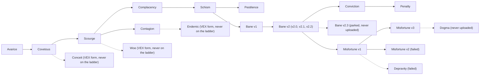

# Cells, calibration probes and experiments

This document covers how cells are designed, generated, and checked, along with calibration probes, simulator experiments, cell lineage, and final ladder status. Terms such as cell, bet, tick, and ladder are defined in [overview.md](overview.md); instruction-level details are in [cell-assembly.md](cell-assembly.md).

## From design to ladder

## How cells are generated

Each cell has a generator `cells/gen_<name>.py` that writes `cells/<name>.asm` and all lookup tables so each rule changes in one place (lookup method in [cell-assembly.md](cell-assembly.md)).

Code rules (`docs/archive/designs.md` 2.7):

- SSE constants are 16-byte aligned; unaligned windows use `movdqu`.
- Every table entry is filled.
- No `org`, `bits`, `section`, or `%include` directives (the site prepends its own header).
- No loops, no stack, and no writes to cell memory on hot paths (project speed rules; the game allows all three, Reference pages 1–2).
- Interface version 4 (`ABI_VERSION` in `docs/cellhack.inc`).

## Instruction counts

Counts include every executed instruction, taken jumps, and the final `ret` (Reference, page 3). Each `.asm` header lists its path counts.

| Path | Instructions | Cell |
|---|---|---|
| Bite, every direction | 6 | Avarice |
| Bite, every direction, no memory (a miss costs the same) | 5 | Covetous, Scourge, Contagion, Complacency, Schism |
| Refill, or split at energy 16 or more | 11 | Scourge, Contagion, Complacency, Schism |
| Repeat bite on the square bitten last time (stored in cell memory) | 4 | Bane v2.1 |
| Split at energy 5 to 15 | 24 or 25 (hold: rest at 27) | Scourge |
| Split at energy 5 to 15, never hold | 16 | Complacency, Schism |
| Boxed feed to a friend with an empty neighbour | 32 to 48 | Schism |
| Split path | 19 to 23 | Avarice |
| Armed bite (stored in advance) | 2 | Misfortune, Depravity |
| First bite of Misfortune (arming step) | 19 (Depravity: 17) | Misfortune v1 and v3, Depravity |
| Queued bite | 3 | Conviction, Penalty |
| Counter bite | 3 | Dogma |
| Gate 1 (refill or split at energy 16 or more) | 15 | Misfortune, Depravity, Dogma |

## The checker

`cells/check_cells.py` runs from the repository root in Linux (or WSL on Windows). It requires NASM; the Unicorn emulator is optional (without it, only static checks run).

- **Static checks:** Source under 64 KB, binary under size limit, no forbidden directives, tables hold valid actions and labels, and instructions are on the allowed list (Unicorn accepts instructions such as `popcnt` that the site rejects).
- **Emulator comparison:** Unicorn runs each cell and `sim/cells_ref.py` on identical inputs and requires matching outputs.
- **Calibration probes:** With Unicorn, reports the instruction count of each probe in `cells/calib/`.
- **Result:** Prints `ALL CHECKS PASSED`, or `ALL OTHER CHECKS PASSED` (exit code 0) when only the shelved VEX cells (`woe`, `conceit`, `endemic`) fail as expected. Any other failure exits with code 1.

### The VEX helper

Unicorn 2.1.4 ignores the first source register of a VEX `vpcmpeqb`, matching the site bug. `cells/vex_emu.py` emulates that behaviour and raises on any other VEX instruction; the checker rejects VEX instructions whose destination is not their first source.

## Calibration probes

Each probe is a small cell testing one engine question via the site's match page (average/max instructions per call and fault log). Because the site form puts a cell straight onto the ladder, `a_rest` played one ladder game by accident; scripted requests saved all other probes without entering the ladder.

| Probe | Question | Result on the site |
|---|---|---|
| `a_rest` | Does `ret` count? | Yes. Average 2 (2). |
| `b_jmp` | Does a taken jump count? | Not run. `e_jexit` shows it does (`mov` + taken `jmp` averaged 2). |
| `c_rax_probe` | Is `rax` zero at entry? | Yes, every call. Average 4 (4), no faults. |
| `d_rep_probe` | Does `rep stosb` count once or per byte? | Per iteration. 100 iterations gave 105. |
| `e_jexit` | Can a call end with a jump to the exit address? | Yes. Average 2 (2); grew to 50 energy. |
| `f_popcnt` | `popcnt` | No. Invalid-instruction fault on every call. |
| `g_ssse3` | `pshufb` (SSSE3) | No. |
| `h_sse41` | `ptest` (SSE4.1) | No. |
| `i_bmi1` | `andn` (BMI1) | No. |
| `j_bmi2` | `pext` (BMI2) | No. |
| `k_avx` | 128-bit VEX `vpcmpeqb` | Yes. Average 3 (3), no faults. |
| `l_avx2` | 256-bit AVX2 (`ymm`) | No. |
| `m_sse42` | `crc32` (SSE4.2) | No. |
| `n_vex_pshufb` | VEX `vpshufb` | No. |
| `o_vex_ptest` | VEX `vptest` | No. |
| `p_vex_unaligned` | VEX with an unaligned memory operand | Yes. Average 3 (3), no faults. |
| `q_xmm_zero` | `xmm0` to `xmm15` zero at entry? | Yes. Average 22 (22), no faults. |
| `r_gpr_zero` | `rbx`, `rcx`, `rbp`, `r8` to `r15` zero at entry? | Yes. Average 15 (15), no faults. |
| `s_vex_src` | Does a VEX compare use its first source or destination? | Destination. Bad-action fault on every call. |
| `t_failed_eat` | Does a failed action earn the +1 of a rest? | No. Energy stayed at 10 for 500 ticks. |

## Experiments in the simulator

Batch sets and accuracy limits are in [simulator.md](simulator.md).

- **Complacency sweep (136 games):** Stopped prey hold at tick 200, 300, 500, or never, plus a diagonal-only variant. Never-hold gave the highest final population in all three mixes; win rates were equal.
- **Complacency on new seeds:** On seeds 9–16 head-to-head, Scourge scored 2.50 points (75%) vs. Complacency 1.75 (12%), but mirror runs showed the winner followed the start slot rather than the cell.
- **VEX cells:** Emulated figures assumed the documented three-operand form, which the site does not run.
- **Solo growth (Schism):** `sim/growth.py` compares split-direction rules for a solo colony; the chosen rule is in `docs/archive/designs.md` 11.1.

## Cell lineage

Solid arrows mean "built from"; dotted arrows mean a looser link (a VEX port, parked/failed branch, or clean-sheet design).

| Cell | Bet | What it does | What it taught |
|---|---|---|---|
| Avarice (cell 149; named `Sprint` until 2026-11-08 in code/data) | None: first ladder cell. | Bites in 6 in every direction; eats greedily; never feeds. | Lost refill races to Atom cells (won 0.5% of 27,339 vs. AtomPush, 3.6% of 6,915 vs. AtomCrasher). Median refill child 25 energy vs. Atom's 6. |
| Covetous (155) | A faster bite is enough. | Bites in 5, no memory; feeds from capped cells; prey hold. | 60.4% wins in its first 217 games. |
| Scourge (156) | Kills convert into land. | Covetous + 11-instruction refill gate (child >=6 energy) + feeding from 16. | Won 74 of its newest 100 games; refilled 98% of rival-eaten squares, but lost the early land grab. |
| Contagion (157) | The grab decides. | Scourge + grab assist, scouts, and feeding from 12. | 70 of first 95 games won (74%). Ahead early, behind at t75–t200; scouts barely used (~6 moves/replay). |
| Complacency (174) | Dropping the prey hold helps. | Scourge with no prey hold (never hold). | Sandbox: 1st with 88 cells (Scourge 82), 2nd with 94 (Scourge 162), 0 faults. Pull 5: still trails Atom cells in first 35 ticks (`docs/archive/designs.md` 10.2). |
| Schism (176) | Feeding the growing edge wins the grab. | Complacency + boxed cells at >=6 energy (no enemy in 5x5) feed the first friend with an empty neighbour. | Sandbox (3 games each vs. Scourge, Covetous, Contagion): places 2, 1, 2 (Complacency 2, 2, 3), 0 faults. Path counts: `docs/archive/designs.md` 11.1. |
| Pestilence (180) | Moving strong cells forward beats splitting a weak child. | Schism + on refill path at >=20 energy, move into freed square instead of splitting (`docs/archive/designs.md` 11.2, change 1 only). | Sandbox 2nd, 0 faults. Ladder: 2nd with 1576 after 377 games (2026-11-10), avg place 1.24 vs. Schism's 1.23. |
| Bane (2026-11-10, `cells/gen_bane.py`) | Prey hold saves children born next to a faster biter. | Schism + Scourge's prey hold (5–15 energy rests with enemy in 5x5). | Replays 123880/123990 (`docs/evidence/contact-study-2026-11-10.md`): rivals bite as fast, stunning border cells ~50% of the time; in t100–200 Schism lost 118 cells vs. Ironbloom's 3. Bane v1 reached ~1300 after 44 games (10th), retired. |
| Bane v2 (`cells/gen_bane2.py`; v2.0, v2.1, v2.2) | Spread-out colonies avoid boxing; fixed bite target beats view scan. | Bane v1 + dispersal opening (first child walks 8, later ones 2 via `MOVE`). v2.1 adds 4-instruction stored repeat bite; v2.2 holds only for diagonal enemies. | v2.0 retired at 1645 (157 games, 1st). v2.1 reached 1775 after 189 games (1804 after 203, avg 1.07, 1st, 189 pts ahead of Colossus). v2.2 (shown as Bane v4) replaced v2.1 on 2026-11-11 15:05 UTC; last read 2026-11-13: 1761 after 1883 games, avg 1.15, 2nd (`docs/archive/designs.md` 11.3). |
| Conviction (`cells/gen_conviction.py`) | Acting on last tick's belief speeds up the bite. | Bane v2.2 + 3-instruction multi-tick bite queue after one look. | 1635 after 155 games. Bitten first in 7–23% of front ticks (vs. 40–88% for Bane v2.2), but refilled only 10% of freed enemy squares (vs. 60%). |
| Penalty (`cells/gen_penalty.py`) | Ending the queue with a split captures the target's square. | Conviction + split into dying target's square. | Test cell; no result kept. |
| Misfortune v1 (350; `cells/gen_misfortune.py`) | A 2-instruction bite is the floor, beating every known cell. | After one look, stores next bites by own energy; later bites take 2 instructions. | Sandbox 146370: 1st, 0 faults. Ladder: 1751 after 172 games, 2nd. |
| Misfortune v2 = AC1 (352; commit `b40b1a4`, generator rewritten for v3) | Checked refill and armed children improve v1. | v1 + checked refill, armed children, no prey hold, feed pad. | Failed: 1326 after 9 games. Slower first bite (19 -> 22+ instructions) and more friendly bites. |
| Misfortune v3 = split10 (353; `cells/gen_misfortune2.py`) | Revert to v1 with one fix. | v1 + cells at >=10 energy split even with an enemy near (`hold='split'`, `hold_min=10`). | Restored 19-instruction first bite and 15-instruction Gate 1 (Unicorn: 59,058 cases, 0 mismatches). Live to the end: 1841 after 441 games, avg 1.17, 3rd. |
| Depravity (363; `cells/gen_depravity.py`) | Without Cap B, a 17-instruction arm step wins the front. | Clean-sheet table jump for arm step, no Cap B, no boxed feeding before tick 200 (`T_FEED = 200`). | Sandbox 1st, but failed on ladder after 5 games (1193) vs. AtomVirus/VarSi. |
| Dogma (`cells/gen_dogma.py`) | 3-instruction counter bite + walker opening beats 2-instruction bite. | Counter bite, first 8/2 walker, rotating `+2`-lane pick. | Passed 49,023 Unicorn checks and 8/8 mutants, but lost to Misfortune v3 locally. NO-GO, never uploaded. |
| Woe, Conceit, Endemic | Same decisions, fewer instructions. | VEX forms of Scourge, Covetous, and Contagion. | Never on ladder (Woe died in Sandbox with 4–5 cells). Broken on site; do not submit. |

### Final ladder status

Every cell that played on the ladder, with its last recorded figures. The ladder log (`data/site-checks.md`) is local only. Editing a cell on the site creates a new cell id starting at rating 1000 ([site-observations-2026-11-08.md](../docs/evidence/site-observations-2026-11-08.md)). Figures for Avarice–Complacency are from 2026-11-10; Schism, Pestilence, and Bane are from 2026-11-11 to 2026-11-13.

| Cell (site id) | Last recorded state | Rating, games | Last recorded place |
|---|---|---|---|
| Avarice | Retired 2026-11-08. | 1191, 886 | 9th |
| Covetous | Retired 2026-11-08. | 1392, 829 | 7th |
| Scourge | Retired 2026-11-08. | 1507, 600 | 2nd |
| Complacency | Taken off by owner 2026-11-08. | 1516, 691 | 2nd |
| Contagion | Taken off by owner 2026-11-09. | 1616, 2145 | 2nd |
| Schism | Retired 2026-11-11. | 1314, 2814 | peak 1675 on 2026-11-09 |
| Pestilence | Taken off 2026-11-11 to free a test slot. | 1250, 1649 | peak 2nd |
| Bane v1 | Retired. | 1307, 44 | 10th |
| Bane v2.0 | Retired 2026-11-11. | 1645, 157 | 1st |
| Bane v2.1 | Replaced by v2.2 on 2026-11-11. | 1804, 203 | 1st |
| Bane v2.2 (site name: Bane v4) | Taken off 2026-11-13 for Misfortune v1; last read 2026-11-13. | 1761, 1883 | 2nd |
| Conviction | Last recorded 2026-11-11. | 1635, 155 | 3rd |
| Penalty | Tester cell; no result kept. | none | none |
| Misfortune v1 (350) | Replaced by v2 on 2026-11-14. | 1751, 172 | 2nd |
| Misfortune v2 = AC1 (352) | Retired (failed). | 1326, 9 | none |
| **Misfortune v3 = split10 (353)** | **Live at last check, 2026-11-14 16:47.** | **1841, 441; avg place 1.17** | **3rd** |
| Depravity (363) | Uploaded 2026-11-14, retired after 5 games; hotfix `e729e16` never uploaded. | 1193, 5 | none |
| Dogma | Built and checked; verdict NO-GO, never uploaded. | none | none |

At the last check, Siect-F led at 2053 (average place 1.05), 212 points ahead of Misfortune v3 (1841). Earlier cells reached 1st place (Scourge, Contagion, Complacency, Schism, Bane v2.0, Bane v2.1), but none held it at the end. Because direction luck shifts win rate by ~16 points, the design notes require at least 50 games before judging a cell.

### Notes on the final rounds

- **Bane v2.3 (2026-11-12 to 2026-11-13, parked):** `cells/gen_bane3.py` cut Bane v2.2's first bite from 16 to 12 instructions (`check_cells`: 931,437 cases, 0 mismatches), but was held so a rating reset would accompany a larger gain ([v23-brief-2026-11-13.md](../docs/archive/briefs/v23-brief-2026-11-13.md)). Misfortune replaced it.
- **Misfortune v2 audit:** Went live before evidence was complete; details in [misfortune2-audit-2026-11-13.md](../docs/archive/reviews/misfortune2-audit-2026-11-13.md) and [final-round-2026-11-13-14.md](../docs/archive/reviews/final-round-2026-11-13-14.md).
- **Depravity hotfix:** The live build was commit `6cfb4a7`. The external reviewer attributed the failure to missing Cap B (48/50 front stalemates) and `T_FEED = 200` (front starvation). Hotfix `e729e16` (currently in `cells/gen_depravity.py` and `cells/depravity.asm`) restored Cap B, but local checks showed no change on front cells, so it was not uploaded.
- **Dogma NO-GO:** Evidence is in [final-round-2026-11-13-14.md](../docs/archive/reviews/final-round-2026-11-13-14.md), section 5.

## Lessons that held up

- A faster first bite decided the front; a 2-instruction bite beat every rival bite encountered.
- Contact alone was not enough: Misfortune won 89% of front bite orders in the studied game against Siect-F, yet lost the equal-area growth race.
- Local simulator results did not predict ladder outcomes for new designs; treat local wins as a signal, not proof.
- A live Sandbox loss against the previous version is a stop signal.
- Test changes against the live version in paired, slot-balanced games, never against a control that already includes the change under test.
- Each upload restarts the rating, so small gains are rarely worth a reset.

## Known limitations

- Conviction and Penalty have no final ladder result in the repository.
- Site name "Bane v4" (cell 289) corresponds to project name Bane v2.2 based on contemporaneous notes (`272` = v1, `277` = v2, `287` = v2.1, `289` = v2.2); the site does not show project version numbers.
- Dogma and the Depravity hotfix were tested only in the local engine.
- Depravity's root cause comes from the external reviewer's analysis and was not verified on the ladder.

## Related documents

- [docs/archive/designs.md](../docs/archive/designs.md): facts, cell designs, and decisions with reasons.
- [scourge-losses-2026-11-08.md](../docs/evidence/scourge-losses-2026-11-08.md) and [contact-study-2026-11-10.md](../docs/evidence/contact-study-2026-11-10.md): loss studies.
- [bane-v22-evidence-2026-11-12.md](../docs/evidence/bane-v22-evidence-2026-11-12.md): measures on Bane v2.2.
- [final-round-2026-11-13-14.md](../docs/archive/reviews/final-round-2026-11-13-14.md): final-round review.
- [data-pulls.md](data-pulls.md): replay data collection; `data/contagion-games-2026-11-08.md` and `data/replay-mining-2026-11-08.md` are local only.
- [simulator.md](simulator.md): how the simulator models these cells.
