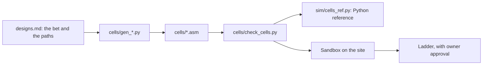
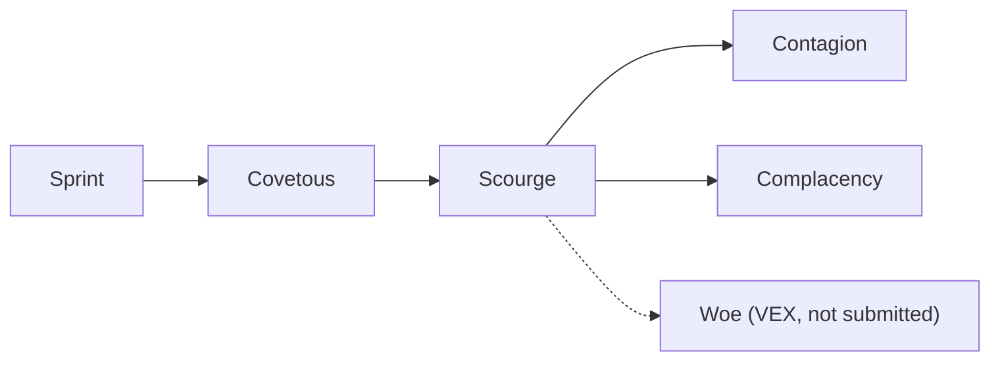

# Cells, calibration probes and experiments

This document explains how the project's cells are designed, generated and checked. It also covers the calibration probes that learned the game's facts, the simulator experiments, and the history of each cell. Terms such as cell, bet, tick and ladder are defined in [overview.md](overview.md).

## From design to ladder

Each cell goes through the same steps. A design decides the bet. A generator writes the assembly. A checker tests it. The Sandbox runs it on the site. Only then can it go on the ladder, and only with the owner's approval.

The checker compares each assembled cell with its Python reference, `sim/cells_ref.py`, in an emulator. So the assembly is checked against an independent statement of the same rules.

## How cells are generated

No cell's lookup tables are typed by hand. Each cell has a generator script, `cells/gen_<name>.py`, that writes the assembly file `cells/<name>.asm`. The generator builds the tables and the code, so a change to a rule is made once, in the script.

The key idea is a one-step lookup. The cell compares one 16-byte window of its view with a constant. A compare sets one bit for each byte that matches. One instruction, `pmovmskb`, collects those bits into a mask. The mask is then used as an index into a table, and the table gives the action to take. Because the lookup takes few instructions, the cell's turn stays short.

The design notes list the code rules for these cells (`designs.md`, section 2.7):

- SSE constants are aligned to 16 bytes. Unaligned windows use `movdqu`.
- Every table entry is filled.
- No `org`, `bits`, `section` or `%include` lines. The site adds its own header.
- No loops, no stack and no writes to the cell memory on the hot paths. These are the project's own speed rules; the game allows all three (Reference, pages 1 and 2).
- The cell is built for interface version 4 (`ABI_VERSION` in `docs/cellhack.inc`).

## Instruction counts

The turn order depends on the number of instructions a cell runs. The count includes every executed instruction, taken jumps and the final `ret`. The Reference states this rule ("The engine counts every instruction", page 3), and the `a_rest` probe confirmed it on the site.

Each cell's paths are counted in the design notes. The main counts are:

| Path | Instructions | Cell |
|---|---|---|
| Bite, 6 in every direction | 6 | Sprint |
| Bite, 5 in every direction, no memory | 5 | Covetous, Scourge, Contagion |
| Refill or split at energy 16 or more | 11 | Scourge |
| Early split with no prey hold | 16 (where Scourge takes 24 or 25) | Complacency |
| Middle split, never hold | 16 | Complacency |
| Split path, as stated in the design notes | 19 to 21 | Sprint |

A bite that finds no enemy costs the same count as the bite path. A short count makes a cell act earlier, so a cell that bites in 5 acts before a cell that bites in 6.

## The checker

`cells/check_cells.py` assembles each cell with NASM, the assembler, and checks it. It is run from the repository root in a Linux shell. On Windows, the shell is WSL. NASM must be installed. The Unicorn emulator is optional. Without it, only the static checks run.

The checker does these things:

- **Static checks.** The source is under 64 KB. The binary is under the size limit. There are no forbidden directives. Tables hold only valid actions. Table entries point to valid labels. Each cell uses only the instructions in an allowed list.
- **Emulator comparison.** Unicorn runs each cell and the Python reference on the same inputs, and the results must match. For Sprint, the inputs cover every combination of the four neighbour types, six energy values, an enemy two squares away on or off, and two tick values. The same kind of comparison runs for each later cell, with more inputs for the later rules.
- **Calibration probes.** With Unicorn installed, the instruction count of each probe in `cells/calib/` is reported.
- **Result.** A full run ends with `ALL CHECKS PASSED`, or with a count of problems and the names of the cells that failed. The shelved VEX cells Woe, Conceit and Endemic always fail. Their problems are listed as expected failures, and the run then ends with `ALL OTHER CHECKS PASSED`. The exit code is 1 only when another cell fails.

The allowed-instruction list matters. Unicorn can run instructions that the site does not support, such as `popcnt` and the SSE4 and BMI sets. The checker therefore rejects them in any cell. Probes showed that the site faults on them.

### The VEX helper

The later VEX cells use AVX-128 forms, which are written with the `v` prefix. Unicorn 2.1.4 ignores the first source register of a VEX `vpcmpeqb`. The site has the same bug. So `cells/vex_emu.py` decodes and runs that one instruction itself, with the site's behaviour. Any other VEX instruction raises an error, so nothing is run with a wrong meaning. The checker also rejects any VEX instruction whose destination is not its first source.

## Calibration probes

A probe is a small cell that answers one question about the game. Each probe has a header comment that says what result to expect. The probe is read on the site's match page. The page shows the average and maximum instructions per call, and a fault log.

The site form puts a cell on the ladder at once. A scripted request saves a cell without putting it on the ladder. One early probe, `a_rest`, played one ladder game by accident before it was taken off. Its later uploads, and the other probes, were saved by scripted request, and none of them went on the ladder. Most probes ran in the Sandbox against the open bots.

| Probe | Question | Result on the site |
|---|---|---|
| `a_rest` | Does `ret` count as an instruction? | Yes. The probe averaged 2 (2). |
| `b_jmp` | Does a taken jump count? | Not run. Not needed: the Reference says the engine counts every instruction (page 3), and the Walker bot's maximum of 9 agrees. |
| `c_rax_probe` | Is `rax` zero at entry? | Yes, on every call. Average 4 (4), no faults. |
| `d_rep_probe` | Does `rep stosb` count once or once per byte? | Once per iteration. The probe's 100 iterations gave a count of 105. |
| `e_jexit` | Can a call end with a jump to the exit address instead of `ret`? | Yes. Average 2 (2), and the cell grew to 50 energy. |
| `f_popcnt` | Is `popcnt` supported? | No. An invalid-instruction fault on every call. |
| `g_ssse3` | Is `pshufb` (SSSE3) supported? | No. |
| `h_sse41` | Is `ptest` (SSE4.1) supported? | No. |
| `i_bmi1` | Is `andn` (BMI1) supported? | No. |
| `j_bmi2` | Is `pext` (BMI2) supported? | No. |
| `k_avx` | Is 128-bit AVX `vpcmpeqb` supported? | Yes. Average 3 (3), no faults. |
| `l_avx2` | Is the 256-bit AVX2 form (`ymm`) supported? | No. |
| `m_sse42` | Is `crc32` (SSE4.2) supported? | No. |
| `n_vex_pshufb` | Is VEX-encoded `vpshufb` supported? | No. |
| `o_vex_ptest` | Is VEX-encoded `vptest` supported? | No. |
| `p_vex_unaligned` | Does a VEX operation accept an unaligned memory operand? | Yes. Average 3 (3), no faults. |
| `q_xmm_zero` | Are `xmm0` to `xmm15` zero at entry? | Yes. Average 22 (22), no faults. |
| `r_gpr_zero` | Are `rbx`, `rcx`, `rbp` and `r8` to `r15` zero at entry? | Yes. Average 15 (15), no faults. |
| `s_vex_src` | Does a VEX compare use its first source or its destination? | The destination. The probe gave a bad-action fault on every call. |
| `t_failed_eat` | Does a failed action earn the +1 that resting earns? | No. Energy stayed at 10 for 500 ticks. |

Probes `f` to `o` also show which instruction sets the site accepts. The site accepts SSE2 and the AVX-128 forms of SSE2 operations. It rejects the other sets.

## Experiments in the simulator

The simulator runs batches of matches to compare cell designs. The batch sets are listed in [simulator.md](simulator.md). The main experiments were these:

- **Complacency sweep.** The tick at which the prey hold stops was tested at 200, 300, 500 and 3000 (never hold). A version that holds only for a diagonal enemy was also tested. The sweep ran 136 games. In all three mixes, the never-hold version had the highest final population. The win rates were the same for every setting.
- **Complacency on new seeds.** On seeds 9 to 16, one head-to-head mix gave Scourge 2.50 points (75%) and Complacency 1.75 points (12%). In a mirror run with the two cells swapped in the mix, the head-to-head winner followed the start slot, not the cell. The design notes conclude that the head-to-head numbers reflect start luck. What held was more land for Complacency and the same win rates.
- **Woe and the VEX cells.** The sim figures for these cells assumed the documented three-operand VEX form. The site does not run that form, so these figures do not describe the site.

The planned experiments E1 to E4 in `designs.md`, section 4, have no recorded results in the sources read for this document. The simulator's accuracy limits apply to all of these results. See [simulator.md](simulator.md).

## Cell lineage

Each cell grew from the one before it. Each new cell kept the decisions that had worked and changed one main thing. The arrows show which cell each one was built from.

| Cell | Bet | What it does | What it taught |
|---|---|---|---|
| Sprint (site cell 149) | None. It was the first ladder cell and the yardstick for later cells. | Bites in 6 instructions in every direction. Eats greedily. Never feeds. | Sprint grabbed land fast, but it never fed, and its children were thin. In races for a freed square, it lost to the Atom cells (AtomPush and AtomCrasher, other players' cells). Against AtomPush it won 0.5% of 27,339 contested races. Against AtomCrasher it won 3.6% of 6,915. Its refill children had a median energy of 25, against 6 for the Atom cells. |
| Covetous (site cell 155) | A faster bite is enough. | Bites in 5 instructions with no memory. Feeds from capped cells, which are cells near 50 energy. Has the prey hold: the split threshold rises to 16 while an enemy is in view. | At the first check, Covetous had 60.4% wins in 217 games. It was later taken off the ladder and replaced by Complacency. |
| Scourge (site cell 156) | Kills convert into land. | Covetous, plus a refill gate for freed front squares (11 instructions, with a child of at least 6 energy), plus feeding from energy 16. It keeps the prey hold from Covetous (a split threshold of 16 while an enemy is in view). | In the newest 100 games, Scourge won 74. Scourge refilled 98% of the squares its rivals ate from it. Most losses were settled by the early land grab, between about tick 100 and tick 200. The write-up calls the prey hold the likely cause of the slow grab. This is a suspicion, not a measured result. The owner took Scourge off the ladder on 2026-11-08 to free a slot. The cell is still saved on the site. |
| Contagion (site cell 157) | The grab decides. | Scourge, plus a grab assist (donors feed a poor neighbour that has room), scouts that move in a straight line from the start square, and feeding from energy 12. | 70 of 95 games won (74%). Contagion grew faster early than Scourge, but it fell behind once contact began, between about tick 75 and tick 200. The scouts were barely used, at about 6 moves per replay. |
| Complacency (site cell 174) | Dropping the prey hold early helps. | Scourge with no prey hold before tick 3000 (never hold). The middle split costs 16 instructions. | Two Sandbox games: first place with 88 cells (Scourge had 82), and second place with 94 cells (Scourge had 162). Both ran with no faults. It went on the ladder on 2026-11-08 with the owner's approval. Its first ladder results are in the table below. |
| Woe, Conceit, Endemic | The same decisions as Scourge, Covetous and Contagion, with fewer instructions. | VEX forms of those three cells. | Not put on the ladder. The site runs the first source of a VEX compare incorrectly. Woe was run in two Sandbox games and died in both, with peaks of 4 and 5 cells while Scourge grew. The design notes mark all three cells as broken on the site and not to be submitted. |

### Ladder results

The ladder keeps a rating for each cell. The figures below are the latest in the repository. Times are local times in the source notes.

| Cell | Latest figure in the repository | Source |
|---|---|---|
| Sprint | Rating 1167 after 828 games (07:17 local, 2026-11-08). | `data/site-checks.md` |
| Covetous | Rating 1299 after 670 games (08:47 local, 2026-11-08). Rating 1348 after 217 games at 01:10 local, with 60.4% wins. | `data/site-checks.md`, `data/covetous-first-games-2026-11-08.md` |
| Scourge | Rating 1511 after 589 games (12:47 local), its last check before it was retired. In its newest 100 games, it won 74 and never placed fourth. | `data/site-checks.md`, `data/scourge-losses-2026-11-08.md` |
| Contagion | Rating 1484 after 254 games (12:47 local). After 95 games it had 1542, with 70 wins, and its rating peaked at 1608. | `data/site-checks.md`, `data/contagion-games-2026-11-08.md` |
| Complacency | Rating 1510 after 69 games (12:47 local), with 66.7% wins. Scourge had 1511 and 67.6% wins at the same check. | `data/site-checks.md` |

Win rates are a rough guide only. The design notes say that direction luck is worth about 16 points of win rate. They ask for at least 50 games before a cell is judged.

## Open items

- Complacency needs more ladder games before it can be compared with Scourge's last rating.
- The experiments E1 to E4 need results, or a note that they were not run.
- The VEX cells are not on the ladder. No fix for them is recorded in the sources read.
- The simulator's late-game model is being improved. See [simulator.md](simulator.md).

## Related documents

- `designs.md`: the facts, the cell designs and the decisions, with the reasons for each.
- `data/scourge-losses-2026-11-08.md` and `data/contagion-games-2026-11-08.md`: the loss studies that shaped the later cells.
- `data/replay-mining-2026-11-08.md`: the refill race numbers.
- [data-pulls.md](data-pulls.md): where the replay data came from.
- [simulator.md](simulator.md): how the simulator models these cells.

See also: [cell-assembly.md](cell-assembly.md), which explains the assembly instructions in the cells and why each one was chosen.
