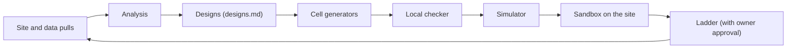

# CellHack2: project overview

This is the starting point for the project. It explains the game, the goal, the parts of the project, how the work is done, and where to read next. Each part has its own document in this folder.

## What CellHack2 is

CellHack2 is an online game. Players write small programs in x86-64 assembly language. Each program is a **cell**. A cell controls one square on a 64 by 64 board.

A **match** has up to four **colonies**. A colony is the group of cells that one player's program makes. A match runs for up to 3000 **ticks**. It can end early. In each tick, every living cell gets one turn. On its turn, a cell can rest, split, move, eat or feed. The colony with the most cells at the end wins. Ties go to more total energy, then to fewer instructions over the match.

The turn order depends on the **instruction count**. This is the number of machine instructions a cell runs on its turn. A cell with fewer instructions acts earlier in the tick. So a short program can take a square before a longer one.

The game has a public ranked list called the **ladder**. Cells on the ladder play real matches against other players' cells. Each cell has a **rating** that goes up or down with its results.

## What the project is for

The goal is to learn what works. The project writes cells for the ladder, tests them, and studies the results. It also collects game records from the site and studies them offline.

Each cell tests one main idea. That idea is the cell's **bet**. Keeping one bet per cell makes the result easier to read. If the cell does well or badly, the reason should be clear.

## Glossary

These terms are used the same way in every document in this folder.

| Term | Meaning |
|---|---|
| Cell | A small x86-64 assembly program that controls one square. Each living cell gets one turn per tick. |
| Colony | All the cells that one player has in one match. A match has up to four colonies. |
| Tick | One round of the game. A match has up to 3000 ticks. |
| Instruction count | How many machine instructions a cell runs on one turn. Fewer instructions means an earlier turn. |
| Energy | A number that each cell holds. It starts at 10 and cannot go above 50. |
| Rest | An action that gives the cell +1 energy. Resting is the only income. |
| Eat | An action that takes up to 2 energy from an adjacent cell. |
| Bite | An eat aimed at an adjacent enemy cell. Only the four neighbours that share an edge count. |
| Stun | A bitten cell that has not had its turn yet in that tick loses that turn. |
| Split | An action that makes a child cell on an empty adjacent square. It needs at least 5 energy. The child gets half the energy, rounded down. The parent keeps the rest. |
| Feed | An action that gives 2 energy to an adjacent friendly cell. It gives less if the cell has less. |
| Refill | A birth or move onto a square that a death freed. In the replays, no refill came in the same tick as its death, and most came one tick later. |
| Prey hold | A rule in the Scourge cell. A cell with 5 to 15 energy and an enemy in its 5 by 5 view rests instead of splitting, until tick 2980. |
| Bet | The one main idea that a cell tests. |
| Ladder | The public ranked list. Cells on it play real matches and have a rating. |
| Sandbox | The site's test area. It runs saved cells against up to three opponents on a 16 by 16 board for 500 ticks. Nothing in it changes the ladder. |
| Simulator | A Python model of the game rules. It is not the real game. See [simulator.md](simulator.md). |
| Calibration probe | A small test cell that answers one question about the game engine. |
| Pull | One round of data collection from the site. The pulls are numbered 1 to 4. See [data-pulls.md](data-pulls.md). |
| Replay | The full record of one match, saved as a file. It lists every birth, move, death, eat and feed. |
| FIT and TEST | Two sets of replayed matches used to check the simulator. FIT (24 matches) is used for tuning. TEST (12 matches) is held back for judging. |

## How the parts connect

The steps run in this order:

1. **Site and data pulls.** Scripts copy match lists, ratings and replays from the site. See [data-pulls.md](data-pulls.md).
2. **Analysis.** Decoders read the replays. Tables and write-ups record what the games show.
3. **Designs.** The design notes turn the findings into one bet for each cell. They also list the instruction count of each path.
4. **Cell generators.** Python scripts in `cells/` write the assembly code. Lookup tables are built by code, not typed by hand.
5. **Local checker.** `cells/check_cells.py` assembles each cell, checks its rules, and compares it with a Python reference.
6. **Simulator.** Many simulated matches test the idea before a site test. The simulator is approximate. See [simulator.md](simulator.md).
7. **Sandbox.** A saved cell plays test matches on the site. Nothing changes on the ladder.
8. **Ladder.** A cell goes on the ladder only with the project owner's approval.

The loop runs in both directions. Ladder results and new replays feed the next analysis, so each new set of cells starts from the newest facts. Cells and their history are covered in [cells-and-experiments.md](cells-and-experiments.md).

## How the work is done

- **AI-assisted.** The cells, scripts and documents were written with Claude, an AI assistant.
- **One bet per cell.** Each cell tests one idea. Results can then be traced to that idea.
- **Calibration probes.** Before a design relies on a game fact, a small probe cell tests it on the site. For example, probes showed that a `ret` counts as one instruction.
- **Facts and assumptions are kept apart.** The design notes mark each fact as verified on the site or in every replay. Anything else is an assumption or an open question.
- **Careful use of the site.** Data is fetched slowly. Ladder changes need the owner's approval.

## Where to start reading

1. This document, for the glossary and the parts.
2. `designs.md`, section 1 (the facts the current design rests on) and section 3 (the cells).
3. [cells-and-experiments.md](cells-and-experiments.md), for how cells are built and checked, and what each cell tried.
4. [simulator.md](simulator.md), for how the simulator works and how far to trust it.
5. [data-pulls.md](data-pulls.md), for where the game data comes from and how it is stored.
6. `data/ladder-data-2-2026-11-08.md`, the main study of ladder matches.

## Repository layout

| Path | What it holds |
|---|---|
| `README.md` | Short entry point with a quick start. |
| `architecture/` | These four documents. |
| `designs.md` | Design notes: verified facts, the cell designs, planned experiments and decisions. |
| `docs/` | The game rules as PDF files, `cellhack.inc` (the constants: interface version 4, ruleset version 9), five open bots in `docs/bots/`, and a list of cell names in `docs/cell_names.txt`. |
| `cells/` | Cell generators (`gen_*.py`), the assembly they write (`*.asm`), the checker `check_cells.py`, the VEX helper `vex_emu.py`, and calibration probes in `calib/`. |
| `sim/` | The simulator, its batch runners and its unit tests in `sim/tests/`. Output goes to `sim/out/`, which git ignores. |
| `tools/` | Data pull scripts (`pull2/`, `pull3/`, `pull4/`) and `privacy_check.py`, which looks for local paths, personal text and model names. `tools/hooks/pre-commit` runs it on each commit (`git config core.hooksPath tools/hooks`). |
| `data/` | Write-ups (`*.md`), and the pulled data in `pull2/`, `pull3/` and `pull4/`. |
| `reviews/` | Earlier design review notes and decision records. |
