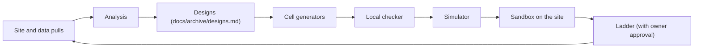

# CellHack2: project overview

This document explains the game, the project goal and outcome, the shared glossary, how the parts connect, and the repository layout. Each subsystem has its own document in `architecture/`.

The project is likely done being updated. The last ladder check was on 2026-11-14.

## What CellHack2 is

CellHack2 is an online game in which players write small x86-64 assembly programs called **cells**. Each cell controls one square on a 64 by 64 board.

A **match** has up to four **colonies** (all cells belonging to one player) and runs for up to 3000 **ticks** (it can end early). Each tick, every living cell gets one turn to rest, split, move, eat, or feed. The colony with the most cells at the end wins; ties go to total energy, then fewer instructions over the match, then lower colony number. Ladder matches award 3, 2, 1, and 0 points by place, which feed the rating (Rules, page 2).

Turn order depends on **instruction count**—the machine instructions a cell executes on its turn. Fewer instructions act earlier in the tick, across all colonies in one pass; ties are broken randomly from the match seed, so matches replay identically (Rules, pages 2–3). Executing more than 1000 instructions faults and the cell does nothing that tick.

The official rules are in `docs/` (Rules, Reference, and Quick start PDFs). When this documentation disagrees with those files, the official files are right.

The game has a public ranked **ladder** where cells play real matches and earn a **rating**.

## What the project was for

The goal was a cell that takes first place on the ladder and stays there. The project did not reach it: **Misfortune v3** (cell 353) reached 2nd and 3rd place, rated 1841 after 441 games (average place 1.17, 3rd place) at the last check on 2026-11-14 at 16:47, behind leader Siect-F at 2053.

The project also aimed to learn what works from ladder matches and offline replay analysis. Each cell tested one main idea—its **bet**—so results stayed readable. See [cells-and-experiments.md](cells-and-experiments.md) for the full cell history and final ladder status.

## Who did what

Claude (Anthropic's AI, via Claude Code) wrote the code and documents. The project owner set the goals and approved every ladder change. In the final days, an external reviewer read designs and results and gave directions, which Claude checked against the data before acting.

## Glossary

These terms are used consistently across `architecture/`.

| Term | Meaning |
|---|---|
| Cell | A small x86-64 assembly program controlling one square. Each living cell gets one turn per tick. |
| Colony | All cells one player has in a match (up to four colonies per match). |
| Tick | One round of the game (up to 3000 ticks per match). |
| Instruction count | Machine instructions executed in one turn. Fewer instructions means an earlier turn. |
| Energy | Per-cell resource. A colony's first cell starts at 10. At the end of each tick (Tidy step), energy above 50 is capped to 50. |
| Rest | Action giving +1 energy—the only source of new energy. |
| Eat | Action taking up to 2 energy from an adjacent cell. |
| Bite | An eat aimed at an adjacent enemy cell (4 edge neighbours only). |
| Stun | A bitten cell that has not acted yet in that tick loses its turn. |
| Split | Action creating a child on an empty adjacent square (requires at least 5 energy). Child gets `floor(energy / 2)`; parent keeps the rest. |
| Feed | Action giving 2 energy to an adjacent cell (friend or enemy). A feeder with `< 2` gives all it has and dies if that empties it. A fed cell that also rests gains 3 energy (`2 + 1`). |
| Refill | A birth or move onto a square freed by a death. Rules forbid entering until the next tick (squares freed by a move can be entered the same tick); replays agree. |
| Prey hold | Rule in Covetous, Scourge, Contagion, and Bane (dropped in Complacency and Schism): a cell at 5–15 energy with an enemy in its 5x5 view rests instead of splitting until tick 2980. Scourge/Contagion still split on refills at >=12 energy; Bane v2.2 holds only for diagonal enemies. |
| Bet | The single main idea a cell tests. |
| Ladder | Public ranked list where cells play rated matches. |
| Sandbox | Site test area: saved cells play up to three opponents on a 16x16 board for 500 ticks without affecting the ladder. |
| Simulator | Python model of the game rules in `sim/`, not the real game. See [simulator.md](simulator.md). |
| Calibration probe | A small test cell that answers one question about the game engine. |
| Pull | One round of data collection from the site. See [data-pulls.md](data-pulls.md). |
| Replay | Full saved record of one match (every birth, move, death, eat, and feed). |
| FIT and TEST | Two sets of replayed matches for checking the simulator: FIT for tuning, TEST held back for judging. See [simulator.md](simulator.md). |
| t*N* (t100) | Tick *N*. "128/512 at t31/t63" means 128 cells at tick 31 and 512 at tick 63. |
| Grab | The early race for empty squares before colonies meet. |
| Front, interior | A front cell has an enemy on a side; an interior cell does not. |
| Freeze tick | Earliest tick after which every colony stays within 5% of its population at that tick. |
| Atom cells | Rival cells AtomPush and AtomCrasher. |
| Rival model | Simulator policy imitating another player's cell. |
| Pump | Feeding style where interior cells pass energy to richer friends toward the front (`rpump` models it). |
| Feeds per eat (f/eat) | A colony's feeds divided by its eats of enemies. |
| Pad, pad3 | `pad=N` adds *N* instructions to a rival model; `pad3` also adds them to slow-direction bites. |
| F5 | The project's memoryless 5-instruction bite in every direction. |
| Boxed | A cell with no empty neighbour (cannot split). |
| Armed bite | A bite stored in cell memory on an earlier tick. Misfortune plays it in 2 instructions without a look; arming takes 19 instructions in Misfortune. |
| Gate 1 | Slow-path check (after the bite test) choosing between refill, split, and rest (15 instructions in Misfortune). |
| Cap B | Rule for boxed cells in Misfortune v1 and v3 that drains rear friends from 48 to 46 energy, preventing a 48/50 energy stalemate at the front (dropped in Depravity). |
| External reviewer | Outside reviewer who read designs and results in the final days and gave directions. |

## How the parts connect

1. **Site and data pulls:** Match lists, ratings, and replays are fetched in a logged-in browser, then decoded and tabulated offline by `tools/replay/`. See [data-pulls.md](data-pulls.md).
2. **Analysis:** Tables and write-ups record what replays show.
3. **Designs:** Design notes turn findings into one bet per cell.
4. **Cell generators:** Python scripts in `cells/` emit the assembly and lookup tables.
5. **Local checker:** `cells/check_cells.py` assembles each cell, checks rules, and compares against a Python reference.
6. **Simulator:** Simulated matches provide an approximate first test. See [simulator.md](simulator.md).
7. **Sandbox:** A saved cell plays test matches on the site.
8. **Ladder:** A cell goes on the ladder only with the owner's approval.

## How the work was done

- **Calibration probes:** Small probe cells verified game facts on the site (for example, that `ret` counts as one instruction) before designs relied on them.
- **Facts vs. assumptions:** Design notes mark each fact as verified on the site or in every replay; anything else is an assumption or open question.
- **Pre-upload checks:** The checker compares every cell against a Python reference on emulated inputs. See [cells-and-experiments.md](cells-and-experiments.md).
- **Owner approval:** Uploading a new version restarts the rating, and removing a cell loses its rating, so the owner approved every ladder change.

## Where to start reading

1. This document, for the game summary, glossary, and repository layout.
2. [cells-and-experiments.md](cells-and-experiments.md), for cell lineage, instruction counts, and final ladder status.
3. [cell-assembly.md](cell-assembly.md), for the x86-64 instructions in the cells and why each was chosen.
4. [simulator.md](simulator.md), for how the simulator works and how far to trust it.
5. [data-pulls.md](data-pulls.md), for where game data came from and which parts are local only.
6. [ladder-data-2-2026-11-08.md](../docs/evidence/ladder-data-2-2026-11-08.md), the main ladder-match study.
7. [docs/archive/README.md](../docs/archive/README.md) (and [docs/archive/designs.md](../docs/archive/designs.md)), for the historical design rounds, reviews, and briefs.

## Repository layout

| Path | What it holds |
|---|---|
| `README.md` | Brief entry point with outcome, quick start, and layout. |
| `architecture/` | Canonical architecture documents. |
| `docs/` | Official game rules (PDF), `cellhack.inc` (interface version 4, ruleset version 9), five open bots in `docs/bots/`, `docs/cell_names.txt`, `docs/evidence/` (six cited study notes), and `docs/archive/` (historical `designs.md`, `reviews/`, and `briefs/`). |
| `cells/` | Cell generators (`gen_*.py`), generated assembly (`*.asm`), `check_cells.py`, `vex_emu.py`, and calibration probes in `calib/`. |
| `sim/` | Python simulator, batch runners, and unit tests in `sim/tests/`. Output goes to `sim/out/` (git-ignored). |
| `tools/` | Replay tools (`replay/`, see [data-pulls.md](data-pulls.md#tools)), opening search (`search/`), and tool tests (`tests/`). |
| `data/` | **Local only, not in the repo.** Replays, match lists, mining output, validation tables, FIT/TEST split, and site-check log. See [data-pulls.md](data-pulls.md). |

## Historical records

Historical design notes (`designs.md`), design reviews, decision records, and dated working briefs from 2026-11-07 to 2026-11-14 live in `docs/archive/`. See [docs/archive/README.md](../docs/archive/README.md) for the full index and legacy-path mapping, and [final-round-2026-11-13-14.md](../docs/archive/reviews/final-round-2026-11-13-14.md) for the end-of-project review.

## Known limitations

- The simulator models growth and rules accurately, but is weak for fights against rival cells; local wins did not predict ladder results in the last round. See [simulator.md](simulator.md).
- Simulator validation requires local `data/` files not in the repo. See [data-pulls.md](data-pulls.md).
- The checker requires NASM and was run only in Linux and WSL, not native Windows.
- Rival models `rsiectf`, `rvarsi`, and `rcolossus` do not match real growth; do not use them to judge a cell.
- The name `Dogma` was used twice: an early note in `docs/archive/designs.md` used it for a dropped deep-pump idea, while the final `Dogma` is the last cell built (see [cells-and-experiments.md](cells-and-experiments.md)).
