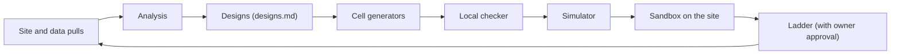

# CellHack2: project overview

This document explains the game, the goal, the outcome, the parts of the project and where to read next. Each part has its own document in this folder.

The project is likely done being updated. The last ladder check was on 2026-11-14.

## What CellHack2 is

CellHack2 is an online game. Players write small programs in x86-64 assembly language. Each program is a **cell**. A cell controls one square on a 64 by 64 board.

A **match** has up to four **colonies**. A colony is the group of cells that one player's program makes. A match runs for up to 3000 **ticks**. It can end early. In each tick, every living cell gets one turn. On its turn, a cell can rest, split, move, eat or feed. The colony with the most cells at the end wins. Ties go to the colony with more total energy, then to the one with fewer instructions over the match, then to the lower colony number. Ladder matches give 3, 2, 1 and 0 points by place, and the points feed the rating (Rules, page 2).

The turn order depends on the **instruction count**. This is the number of machine instructions a cell runs on its turn. A cell with fewer instructions acts earlier in the tick. So a short program can take a square before a longer one. All colonies share one pass per tick, and cells with equal counts are put in a random order. All randomness comes from the match seed, so a match replays identically (Rules, pages 2 and 3). A call over 1000 instructions is a fault, and the cell does nothing that tick.

The official rules are in `docs/` (Rules, Reference and Quick start, as PDF files). When this documentation and those files disagree, the official files are right.

The game has a public ranked list called the **ladder**. Cells on the ladder play real matches against other players' cells. Each cell has a **rating** that goes up or down with its results.

## What the project was for

The goal was a cell that takes first place on the ladder and stays there. The project did not reach it. The best cell, Misfortune v3, reached second and third place. At the last check (2026-11-14 16:47) it was rated 1841 after 441 games, with an average place of 1.17, in third place. The leader, Siect-F, was rated 2053.

The project also aimed to learn what works. It learned this from ladder cells and from game records that it studied offline.

Each cell tested one main idea. That idea is the cell's **bet**. One bet per cell made each result easier to read. The history of every cell is in [cells-and-experiments.md](cells-and-experiments.md).

## Who did what

Claude, Anthropic's AI, wrote all code and documents through Claude Code. The project owner set the goals and approved every step that changed the ladder. In the last days, an external reviewer read designs and results and gave directions. Claude checked those directions against the data before it acted.

## Glossary

These terms are used the same way in every document in this folder.

| Term | Meaning |
|---|---|
| Cell | A small x86-64 assembly program that controls one square. Each living cell gets one turn per tick. |
| Colony | All the cells that one player has in one match. A match has up to four colonies. |
| Tick | One round of the game. A match has up to 3000 ticks. |
| Instruction count | How many machine instructions a cell runs on one turn. Fewer instructions means an earlier turn. |
| Energy | A number that each cell holds. A colony's first cell starts at 10. At the end of each tick (the Tidy step), the game cuts energy above 50 back to 50. So a cell can hold more than 50 for part of a tick. |
| Rest | An action that gives the cell +1 energy. It is the only source of new energy. |
| Eat | An action that takes up to 2 energy from an adjacent cell. |
| Bite | An eat aimed at an adjacent enemy cell. Only the four neighbours that share an edge count. |
| Stun | A bitten cell that has not had its turn yet in that tick loses that turn. |
| Split | An action that makes a child cell on an empty adjacent square. It needs at least 5 energy. The child gets half the energy, rounded down. The parent keeps the rest. |
| Feed | An action that gives 2 of the feeder's energy to the cell in the chosen direction. The target can be a friend or an enemy. A feeder with less than 2 gives all it has, and dies if that was all of it. A fed cell that also rests gains 3 in that tick (2 + 1). Feeding gives no bonus. |
| Refill | A birth or move onto a square that a death freed. The Rules say nobody can enter such a square until the next tick. (A square freed by a move can be entered in the same tick.) The replays agree: no refill came in the same tick as its death, and most came one tick later. |
| Prey hold | A rule in Covetous, Scourge, Contagion and Bane. Complacency and Schism drop it. A cell with 5 to 15 energy and an enemy in its 5 by 5 view rests instead of splitting, until tick 2980. In Scourge and Contagion, a refill at 12 energy or more still splits. Bane v2.2 holds only with an enemy on a diagonal square. |
| Bet | The one main idea that a cell tests. |
| Ladder | The public ranked list. Cells on it play real matches and have a rating. |
| Sandbox | The site's test area. It runs saved cells against up to three opponents on a 16 by 16 board for 500 ticks. Nothing in it changes the ladder. |
| Simulator | A Python model of the game rules. It is not the real game. See [simulator.md](simulator.md). |
| Calibration probe | A small test cell that answers one question about the game engine. |
| Pull | One round of data collection from the site. See [data-pulls.md](data-pulls.md). |
| Replay | The full record of one match, saved as a file. It lists every birth, move, death, eat and feed. |
| FIT and TEST | Two sets of replayed matches used to check the simulator. FIT is used for tuning. TEST is held back for judging. Sizes and results are in [simulator.md](simulator.md). |
| t*N* (t100) | Tick *N*. "128/512 at t31/t63" means 128 cells at tick 31 and 512 at tick 63. |
| Grab | The early race for empty squares, before colonies meet. |
| Front, interior | A front cell has an enemy on a side. An interior cell does not. |
| Freeze tick | The earliest tick after which every colony stays within 5% of its population at that tick. |
| Atom cells | The rival cells AtomPush and AtomCrasher. |
| Rival model | A simulator policy that imitates another player's cell. |
| Pump | A feeding style: interior cells pass energy to richer friends, toward the front. `rpump` models it. |
| Feeds per eat (f/eat) | A colony's feeds divided by its eats of enemies. |
| Pad, pad3 | `pad=N` adds *N* instructions to a rival model, to match a slow rival. pad3 also adds them to its slow-direction bites. |
| F5 | The project's bite: 5 instructions in every direction, with no memory. |
| Boxed | A cell with no empty neighbour. It cannot split. |
| Armed bite | A bite that the cell stored in its memory on an earlier tick. Misfortune plays it in 2 instructions, without a look. The first look and store ("arming") takes 19 instructions in Misfortune. |
| Gate 1 | The check on the slow path (after the bite test) that decides between a refill, a split and a rest. In Misfortune it takes 15 instructions. |
| Cap B | A rule for boxed cells in Misfortune v1 and v3. It drains rear friends from 48 to 46 energy. This stops a 48/50 energy stalemate at the front. Depravity dropped it. |
| External reviewer | An outside reviewer who read the designs and results in the last days and gave directions. |

## How the parts connect

The steps run in this order:

1. **Site and data pulls.** Match lists, ratings and replays are fetched from the site in a logged-in browser. Offline Python tools in `tools/replay/` then decode and tabulate them. See [data-pulls.md](data-pulls.md).
2. **Analysis.** Tables and write-ups record what the replays show.
3. **Designs.** The design notes turn the findings into one bet for each cell.
4. **Cell generators.** Python scripts in `cells/` write the assembly code and its lookup tables.
5. **Local checker.** `cells/check_cells.py` assembles each cell, checks its rules, and compares it with a Python reference.
6. **Simulator.** Simulated matches give an approximate first test. See [simulator.md](simulator.md).
7. **Sandbox.** A saved cell plays test matches on the site.
8. **Ladder.** A cell goes on the ladder only with the project owner's approval.

Ladder results and new replays fed the next analysis. Cells and their history are covered in [cells-and-experiments.md](cells-and-experiments.md).

## How the work was done

- **Calibration probes.** Before a design relied on a game fact, a small probe cell tested it on the site. For example, probes showed that a `ret` counts as one instruction.
- **Facts and assumptions were kept apart.** The design notes mark each fact as verified on the site or in every replay. Anything else is an assumption or an open question.
- **Every cell was checked before upload.** The checker compares each cell with a Python reference on emulated inputs. See [cells-and-experiments.md](cells-and-experiments.md).
- **Ladder changes needed approval.** A new upload restarts the rating, and taking a cell off the ladder loses its rating. So the owner approved each change.

## Where to start reading

1. This document, for the glossary and the parts.
2. [cells-and-experiments.md](cells-and-experiments.md), for the lineage of cells and the final ladder status.
3. [designs.md](../designs.md), for the final state at the top, then the facts (section 1) and the dated design rounds.
4. [cell-assembly.md](cell-assembly.md), for the instructions in the cells and why each was chosen.
5. [simulator.md](simulator.md), for how the simulator works and how far to trust it.
6. [data-pulls.md](data-pulls.md), for where the game data came from and which parts are local only.
7. [ladder-data-2-2026-11-08.md](../docs/evidence/ladder-data-2-2026-11-08.md), the main study of ladder matches.

## Repository layout

| Path | What it holds |
|---|---|
| `README.md` | Short entry point with the outcome and a quick start. |
| `architecture/` | These architecture documents. |
| `designs.md` | Design notes: the final state, verified facts, the cell designs, experiments and decisions. |
| `docs/` | The game rules as PDF files, `cellhack.inc` (the constants: interface version 4, ruleset version 9), five open bots in `docs/bots/`, and a list of cell names in `docs/cell_names.txt`. |
| `docs/evidence/` | Six study notes copied from the working data. Code comments and documents cite them. |
| `cells/` | Cell generators (`gen_*.py`), the assembly they write (`*.asm`), the checker `check_cells.py`, the VEX helper `vex_emu.py`, and calibration probes in `calib/`. |
| `sim/` | The simulator, its batch runners and its unit tests in `sim/tests/`. Output goes to `sim/out/`, which git ignores. |
| `tools/` | The replay tools (`replay/`, see [data-pulls.md](data-pulls.md#tools)), `search/` (the opening search), and `tests/` (tests of the tools, run with `python -m unittest discover -s tools/tests`). |
| `reviews/` | Design reviews and decision records. See the index below. |
| `briefs/` | Dated briefs, hand-over notes and build checks. See the index below. |
| `data/` | **Local only, not in the repo.** Replays, pulled match lists, mining output, validation tables, the FIT and TEST split and the site-check log. See [data-pulls.md](data-pulls.md). |

## Index of reviews

All files are in `reviews/`. Paths to `data/` inside them point to local files that are not in the repo. The files are historical records. They were edited only to fix paths.

| File | What it is |
|---|---|
| [final-round-2026-11-13-14.md](../reviews/final-round-2026-11-13-14.md) | The last round: growth gates, the armed-children cell and its failure, the Depravity build and live failure, the Dogma gauntlet and its NO-GO. Start here for the end of the project. |
| [misfortune2-audit-2026-11-13.md](../reviews/misfortune2-audit-2026-11-13.md) | Audit and post-mortem of Misfortune v2, with the list of dead ends. |
| [dogma-clean-sheet-review-2026-11-14.md](../reviews/dogma-clean-sheet-review-2026-11-14.md) | Clean-sheet review of the field and the Dogma spec. |
| [r1-rules.md](../reviews/r1-rules.md), [r1-asm.md](../reviews/r1-asm.md), [r1-strategy.md](../reviews/r1-strategy.md) | Round 1 reviews of the rules, the assembly and the strategy. |
| [decisions-r1.md](../reviews/decisions-r1.md) | Decisions after round 1. |
| [r2-review.md](../reviews/r2-review.md), [r3-review.md](../reviews/r3-review.md) | Round 2 and round 3 reviews. |
| [designs-r1-snapshot.md](../reviews/designs-r1-snapshot.md), [designs-r2-snapshot.md](../reviews/designs-r2-snapshot.md), [designs-r3-snapshot.md](../reviews/designs-r3-snapshot.md) | Copies of `designs.md` at the end of rounds 1 to 3. |

## Index of briefs

All files are in `briefs/`. They are dated working documents. Some name files in the local `data/` folder.

| File | What it is |
|---|---|
| [contact-brief-2026-11-10.md](../briefs/contact-brief-2026-11-10.md) | The contact study of the new rivals and the plan for Bane v1 and v2. |
| [resume-2026-11-10.md](../briefs/resume-2026-11-10.md), [resume-2026-11-11.md](../briefs/resume-2026-11-11.md) | Hand-over notes for a fresh session. |
| [deep-review-2026-11-13.md](../briefs/deep-review-2026-11-13.md) | What the measures on Bane v2.2 say, and the path forward. |
| [v23-brief-2026-11-13.md](../briefs/v23-brief-2026-11-13.md), [v23-review-prompt-2026-11-13.md](../briefs/v23-review-prompt-2026-11-13.md) | The build plan for Bane v2.3 (parked) and its review prompt. |
| [misfortune-spec-2026-11-13.md](../briefs/misfortune-spec-2026-11-13.md) | The final spec of Misfortune. |
| [misfortune-build-review-2026-11-13.md](../briefs/misfortune-build-review-2026-11-13.md), [misfortune-asm-check-2026-11-13.md](../briefs/misfortune-asm-check-2026-11-13.md), [misfortune2-asm-check-2026-11-13.md](../briefs/misfortune2-asm-check-2026-11-13.md) | The build review and the assembly checks of Misfortune v1 and v2. |
| [misfortune-byte-dumps-2026-11-13.txt](../briefs/misfortune-byte-dumps-2026-11-13.txt) | Byte dumps of the Misfortune build. |

## Known limitations

- The simulator is accurate for growth and for the rules. It is weak for fights against rival cells. Local wins did not predict ladder results in the last round. See [simulator.md](simulator.md).
- The validation of the simulator needs local data that is not in the repo. See [data-pulls.md](data-pulls.md).
- The checker needs NASM. It ran in Linux and WSL only, not on native Windows.
- The rival models `rsiectf`, `rvarsi` and `rcolossus` do not match real growth. Do not use them to judge a cell.
- The name `Dogma` was used for two things. An early note (the header of `designs.md`) used it for a deep-pump idea that the project dropped. The final `Dogma` is the last cell built (see [cells-and-experiments.md](cells-and-experiments.md)).
