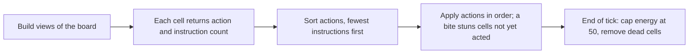

# The simulator (sim/)

The simulator plays CellHack2 matches on a PC. It runs no assembly. A Python function replaces each cell and returns the action and the number of instructions that the real cell would run. Use it for early checks only. It does not replace a Sandbox test or a ladder result.

## What it models

| Part of the game | How the simulator handles it |
|---|---|
| Board | 64 by 64, up to four colonies, up to 3000 ticks. The edge acts as a wall. |
| Starting cells | One cell per colony, at energy 10. `run.py` and `experiments.py` use random squares at least 8 steps apart (Manhattan). Replays of real matches use the real starts. |
| View | Own energy, age, position and colony, a random byte, population counts, and a 5 by 5 window of neighbour types and energies. |
| Actions | Rest (+1 energy), move, split, eat, feed, do nothing. |
| Turn order | Fewest instructions first. The match seed shuffles ties. |
| Stuns | A bite that reaches a cell before its turn removes that turn. |
| Energy cap | 50, applied at the end of each tick. |
| Faults | An exception, a bad return or an unknown action makes the cell do nothing that tick. So does a call over 1000 instructions (budget fault). |
| Memory | 64 bytes per cell, kept between turns. A child copies its parent's memory. |

## Files

| File | What it does |
|---|---|
| `engine.py` | The rules engine: board, turn order, constants from `docs/cellhack.inc`. |
| `bots.py` | The five open bots from `docs/bots/`, with their instruction counts. |
| `cells_ref.py` | Python reference versions of the project's cells. `cells/check_cells.py` compares the assembly with them. |
| `rivals.py` | Rival models based on direction habits seen in replays. |
| `policies.py` | Registry that turns a name such as `rpump` into a policy function. |
| `experiments.py` | Runs many matches in parallel and collects replay-style statistics. |
| `run.py` | One match or a series of seeds. |
| `batch.py` | Runs a named set unattended and writes a summary. |
| `validate.py` | Replays the matches of every pull in `data/` (each folder with a `validation-table.md`) and compares them with the real results. `--pull <pull>` limits it to one pull. |
| `treadmill.py` | Compares late-game measures of replays and simulator, such as land changes after tick 500. |
| `baseline.py` | Rating and win-share baselines for the winner check. It has no ratings for pull 5 yet. |
| `ceiling.py` | Estimates the best possible winner score from extra seeds on TEST. It needs a stored seed-0 run that a fresh checkout lacks. |
| `growth.py` | Solo-colony study of split-direction rules (Schism, `designs.md` 10.4). |
| `replay_check.py` | Drives the engine with the recorded actions of real replays, without cell code or rival models, and compares every square with the replay. `--pull <pull> [ids]`. |
| `tests/` | Unit tests. |

The policy interface, engine options and full assumption list are in [sim/README.md](../sim/README.md).

## Policies

A policy is a plain Python function. It takes the view and the memory, and returns an action and an instruction count. It keeps no other state, because the real cell has only its 64 bytes. The count must match the real path, because the turn order depends on it.

| Name | Type | What it models |
|---|---|---|
| `rbrawler` | Measured | Checks up, left, right, down. Feeds poorer friends. |
| `rpump` | Measured | Like `rbrawler`, but interior cells feed their richest friend. |
| `ratompush` | Measured | Checks right, left, up, down. Assists poor friends with room to grow. |
| `rblind3` | Hypothetical | Bites at 3 instructions in every direction, with no memory. |
| `rlock5`, `rfatgrab` | Hypothetical | Variants with other bite costs (see `rivals.py`). |
| `rblindlock3` | Hypothetical | Earlier `rblind3`: a blind lock that bites at 9, then at 3. |

Hypothetical models are for comparison only. No measured rival uses a lock.

The default model for each ladder cell is in `MODELS` in `sim/validate.py`. Aegis, Noob++ and rooby use the pad3 models, with `pad` and `pad_bites_from` set. The options `pad`, `pad_bites_from` and `split_after` slow a model. They are off unless a model spec sets them. AtomPush and AtomCrasher set `assist_min` (6 and 8) and `feed_margin=6`, so they assist earlier and stop feeding between full cells.

## Running it

Run these from `sim/`. Runners use at most four workers (`--workers` changes this) and below-normal priority on Windows.

| Command | What it does |
|---|---|
| `python -m unittest` | Runs the unit tests. |
| `python run.py` | One match: Hunter, Medic, Random, Walker. |
| `python run.py --bots hunter,idle,medic,walker --seeds 1-20` | A series of seeds. Slots rotate between games. |
| `python run.py --bots mymodule:mypolicy,hunter` | Plays your own policy, if `sim/` can import its module. |
| `python experiments.py --mix sprint,rbrawler,ratompush,walker --seeds 1-8` | A mix over many seeds: points, win rate, average place, final population. |
| `python batch.py --set rivals` | A named set. The console prints only the summary path. |
| `python validate.py --extend-split` | Gives new matches a FIT or TEST set (see [data-pulls.md](data-pulls.md)). |
| `python treadmill.py --set fit --workers 4` | Late-game comparison (`--set test` for TEST). |

Slot position changes results, so the simulator rotates slots when it compares policies.

Batch sets write a summary (`.md`) and a full file (`.json`) to `sim/out/`, which git ignores.

| Set | What it asks | Games and recorded time |
|---|---|---|
| `rivals` | Sprint against the rival models | 24 games, 12 to 15 minutes |
| `hypothetical` | Hypothetical fronts against the measured models | 16 games, 8 to 10 minutes |
| `validate` | Every validation match with its real starts | One game per match; mean 84 to 93 seconds per game, 141 seconds at most |
| `complacency-t` | Sweep of the tick at which the prey hold stops | 136 games, 3148 seconds |
| `complacency`, `complacency-mirror` | Complacency against Scourge, new seeds and swapped slots | 40 and 16 games, 19 and 9 minutes |
| `vex` | VEX variants against their parents | 120 games, time not recorded |
| `smoke` | Tiny set for the tests | Not timed |

## How far to trust it

This section is the only home of the simulator's accuracy figures. Other documents link here.

The validation pool has 135 matches: 90 FIT, 45 TEST. `data/splits/split.json` fixes the set of each match. A match never changes set.

| Pulls | Matches | FIT | TEST |
|---|---|---|---|
| 2 to 4 | 63 | 42 | 21 |
| 5 | 72 | 48 | 24 |

Engine rules, checked 2026-11-08 with `replay_check.py` on 8 replays from pulls 2 to 5: about 87.8 million squares compared one tick at a time after first contact, 9 differ, none in move, split, feed or death. All 9 are bite energies off by 1. The one inspected is a killed cell that rested before the bite, which the replay does not record. In 50-tick free runs between keyframes, 6 of about 1.74 million squares differ. No engine rule needed a change. The check cannot test what replays do not record: the instruction counts behind the turn order, REST against NOP (inferred from the energy), and rival behaviour. The figures below are therefore errors of the rival models, not of the rules.

State measured at commit 471711c, before these model changes: Atom `assist_min` and `feed_margin`. One seed per match, real starts (`designs.md` 10.6 has the same figures). Same winner: the largest final population matches the real winner. Checks: rows of `validate.thresholds` that pass. Rating baseline: the highest pre-match rating wins.

| Set | Matches | Same winner | Checks | Rating baseline | Win-share baseline |
|---|---|---|---|---|---|
| TEST | 45 | 71% (32/45) | 51/63 | 49% (22/45) | 53% (24/45) |
| TEST, pull 5 only | 24 | 62% (15/24) | 46/59 | 62% (15/24) | 58% (14/24) |
| FIT | 90 | 70% (63/90) | 47/63 | 44% (40/90) | 59% (53/90) |

The win-share baseline is in-sample, so it is optimistic.

**Main result.** On pull 5 TEST, the only data never used for tuning, the simulator does no better than "the higher rating wins". Do not use its win rates against the rival field as evidence.

| Area | Trust | Evidence |
|---|---|---|
| Own-colony growth before contact | Good | No rival model is involved. Simulated Scourge and Complacency reach 128 cells at t37; the real range is t36-44. |
| Atom models | Weak | Before the change at 471711c: 36-38 feeds per eat against 7-9 real, and 25-30% too slow to t100. After it, on 8 FIT matches (real/sim medians): t100 AtomPush 941/872 (was 744), AtomCrasher 835/824 (was 774). Feeding now undershoots: 0.2-0.4 feeds per eat pooled, against 6.2 and 17.8 real pooled. `feed_margin` 2 feeds too much and 6 too little; values between are untested. |
| Pump models | Weak | Feed about half the real amount. Hold about 6 more energy at t200. |
| Noob+ late land | Wrong | Median final population: real 0, simulator 1821. 8 wrong winners of 135. |
| Early-fill games | Weak | Scourge over-wins when the real winner fills the board by about t300. Winner accuracy with a real freeze at or before t600 is 10/20. |
| rooby | Weak | Dead at the end in 24 of 34 simulated games; 16 of 34 real games. |
| Fed +3 share | Wrong | 88-90% against 73% real. The simulator never produces the +0 fed outcome. |

Tuning is paused by the owner. Tuning targets are in `designs.md` 10.6.

## Main assumptions

The docs do not settle every rule. [sim/README.md](../sim/README.md) lists all assumptions and which can be switched.

| Assumption | Why it matters |
|---|---|
| Starts are random squares at least 8 steps apart (Manhattan). | The Rules say only one cell each at 10 energy. Ladder replays show non-corner starts. The real distribution is not fully known. |
| A split gives the child half the energy, rounded down. | Replays confirmed the rounding. |
| Memory changes persist when a cell is stunned. | Matters only for designs that use memory at the front. |
| A newborn is on the board at once, but takes no turn until the next tick. | Newborns can be bitten in their birth tick. |
| A failed action earns no energy. | Sandbox probe `t_failed_eat` confirmed this. |
| The order of random draws in the real engine is unknown. | Seeds do not reproduce real matches. |

## Related documents

- [sim/README.md](../sim/README.md): interface, options, assumptions, calibration log.
- `designs.md`, sections 8, 9 and 10: simulator results for the later cells and the current plan.
- [cells-and-experiments.md](cells-and-experiments.md): how the simulator fits into the cell work.
