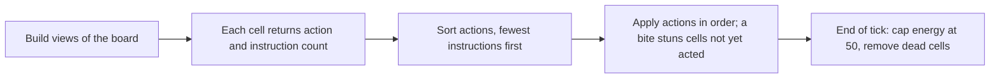

# The simulator (sim/)

The simulator plays CellHack2 matches on a PC. It follows the game rules closely enough to compare ideas quickly. It does not run any assembly code. Each cell is replaced by a Python function. That function returns the cell's action and the number of instructions the real cell would run for that action.

The simulator is useful for early checks. It is not a substitute for a Sandbox test or a ladder result. Its accuracy is covered in the section "How far to trust it" below.

## What it models

| Part of the game | How the simulator handles it |
|---|---|
| Board | A 64 by 64 board with up to four colonies and up to 3000 ticks. The edge of the board acts as a wall. |
| Starting cells | One cell per colony, at energy 10. By default the starts are random squares at least 8 steps apart (Manhattan distance). |
| What a cell sees | Its own energy, age, position and colony, a random byte, the population counts, and a 5 by 5 window of neighbour types and energies. |
| Actions | Rest (+1 energy), move, split, eat, feed, and do nothing. |
| Turn order | Each tick, the cells act in order of instruction count, fewest first. Ties are shuffled with the match's random seed. |
| Bites and stuns | A bite that reaches a cell before its turn removes that turn for the tick. |
| Energy cap | Energy is capped at 50 at the end of each tick. |
| Faults | An exception, a missing or malformed return, or an unknown action makes the cell do nothing that tick. A call over 1000 instructions is a budget fault, and the cell does nothing that tick. |
| Memory | Each cell has 64 bytes that persist between its turns. A child copies its parent's memory. |

Each tick runs in these steps:

## Files

| File | What it does |
|---|---|
| `engine.py` | The rules engine. It holds the board, the turn order and the constants from `docs/cellhack.inc`. |
| `bots.py` | The five open bots (Hunter, Medic, Walker, Random, Idle), ported from `docs/bots/`, with their instruction counts. |
| `cells_ref.py` | Python reference versions of the project's own cells. The checker compares the assembly with these. |
| `rivals.py` | Rival models based on the direction habits seen in real replays. |
| `policies.py` | A registry that turns a name such as `rpump` into a policy function. |
| `experiments.py` | Runs many matches in parallel and collects replay-style statistics. |
| `run.py` | Command-line tool for one match or a series of seeds. |
| `batch.py` | Runs a named set of experiments unattended and writes a summary. |
| `validate.py` | Replays the 36 pull 2 ladder matches and compares them with the real results. |
| `treadmill.py` | Compares late-game measures of the real replays and the simulator, such as land changes after tick 500. |
| `tests/` | Unit tests. Run them with `python -m unittest` from `sim/`. |

The full policy interface, the engine options and the list of assumptions are in [sim/README.md](../sim/README.md).

## Writing a policy

A policy is a plain Python function. It takes the cell's view and its memory, and it returns an action and an instruction count. It keeps no state of its own, because the real assembly cell has no state beyond its 64 bytes of memory. The instruction count must match the path the real cell would run. Keeping the count honest matters, because the turn order depends on it.

The rival models follow the same rules. They are tuned to match the behaviour seen in real replays.

| Name | Type | What it models |
|---|---|---|
| `rbrawler` | Measured | Checks the four directions in a fixed order (up, left, right, down) and feeds poorer friends. |
| `rpump` | Measured | Like `rbrawler`, but feeds its richest friend from the interior of its colony. |
| `ratompush` | Measured | Checks right, left, up, down and assists poor friends that have room to grow. |
| `rblind3` | Hypothetical | Bites at 3 instructions in every direction, with no memory. |
| `rlock5`, `rfatgrab` | Hypothetical | Variants with different bite costs. Their exact paths are in the `rivals.py` docstrings. |
| `rblindlock3` | Hypothetical | An earlier version of `rblind3`. It has a blind lock that bites at 9 first, then at 3. |

The measured models come from real replays. The hypothetical models test what would happen if a rival used a different front, and they are for comparison only. No measured rival uses a lock.

## Running it

Run these commands from the `sim/` folder. Each runner uses at most four worker processes, and it runs at below-normal priority on Windows.

| Command | What it does |
|---|---|
| `python -m unittest` | Runs the whole unit test suite. |
| `python run.py` | Plays one match with the default cells (Hunter, Medic, Random and Walker). |
| `python run.py --bots hunter,idle,medic,walker --seeds 1-20` | Plays a series of seeds. Slots rotate between games. |
| `python run.py --bots mymodule:mypolicy,hunter` | Plays your own policy, if its module can be imported from `sim/`. |
| `python experiments.py --mix sprint,rbrawler,ratompush,walker --seeds 1-8` | Plays a mix of policies over many seeds and prints points, win rates, average place and final population. |
| `python batch.py --set rivals` | Runs a named set unattended. The console prints only the summary path. |

Slot position changes results. In one check with four Hunter cells, the bottom-left colony won all of seeds 1 to 8. Its fronts point up and right, where Hunter's bite paths are cheapest (7 and 10 instructions), so it acts first. For this reason, the simulator rotates the slots when it compares policies.

Batch sets write a summary of under 60 lines (`.md`) and a full file of every match (`.json`) to `sim/out/`. Git ignores that folder.

| Set | What it asks | Size and time (from the sim README and design notes) |
|---|---|---|
| `rivals` | Sprint against the direction-ordered rival models | 24 games, about 12 to 15 minutes |
| `hypothetical` | Hypothetical fronts against the measured models | 16 games, about 8 to 10 minutes |
| `validate` | The 36 ladder matches replayed with their real starts | About 18 to 20 minutes |
| `complacency-t` | Sweep of the tick at which the prey hold stops (see [cells-and-experiments.md](cells-and-experiments.md)) | 136 games, 3148 seconds in the recorded run |
| `complacency`, `complacency-mirror` | Complacency against Scourge, on new seeds and with the slots swapped | 40 and 16 games, about 19 and 9 minutes in the recorded runs |
| `vex` | VEX variants against their parents | Run time not recorded in the sources |
| `smoke` | A tiny set used by the tests | Not timed |

## How far to trust it

The simulator was checked against real ladder matches from pull 2. The check used the same start squares and the nearest model for each cell. It compared the winners and the population curves with the real replays.

- **Same winner.** In the final run over all 36 matches, the simulator picked the same winner as the real game in 26 of 36 matches.
- **Held-out checks.** 12 of the 36 matches were kept back as the TEST set. The other 24 form the FIT set, which was used for tuning. With the default models, the simulator passes 49 of 63 checks on FIT and 47 of 62 checks on TEST.
- **Early game is the better-modelled part.** For roughly the first 200 ticks, the simulated growth follows the real replays closely. In a two-match smoke test, Sprint's population at tick 200 was 1884 in the real match and 1874 in the simulation. Two matches are not a sample, so treat this as a sign and not as proof.
- **Late game is weak.** After about tick 500, the simulator is less reliable. Thin pump colonies keep their land in the simulator, but they lose it in real matches. In the final run, the simulated Brawler and Noob+ colonies held 900 to 1600 cells at tick 1000, against 2 to 16 in the real replays. The sim README says the fight and refill model is what is off, not the feeding.
- **Late-game work so far.** The tool `treadmill.py` compares late-game measures of the real replays and the simulator. Run it from `sim/` with `python treadmill.py --set fit --workers 4` (or `--set test`). It showed that some rival cells are slower on the site than in the models. Three new options can slow a model down: `pad`, `pad_bites_from` and `split_after` (for `ratompush` and `rpump`; see sim/README.md). They are all off by default.
- **Candidate not adopted.** The candidate "pad3" slows three rivals: Noob++ (pad 66), rooby (pad 56) and Aegis (pad 12), with slow bites padded too. It gives 49 of 62 checks on TEST, but only 46 of 63 on FIT. FIT is the set for tuning, and it got worse. Thus the defaults did not change.
- **Still not explained.** Noob+ and Brawler v2 keep their land late in the simulator, but they lose it in real matches. Early in the game, thin pump colonies lose front cells at about half the real rate. The Atom cells feed 2 to 6 times more than in the real replays. The early contact geometry is already different from the real replays by tick 100. Treat results that depend on late-game land as provisional.

The sim README gives the same advice. Do not trust the simulator for outcomes between Sprint and pump colonies, or for late-game land.

## Main assumptions

The docs do not settle every rule, so the simulator makes some assumptions. The list below shows the most important ones. The sim README lists all of them, and it marks which ones can be switched.

| Assumption | Why it matters |
|---|---|
| Starts are random squares at least 8 steps apart (Manhattan). | The Rules only say that four colonies start with one cell each, at 10 energy. Only a comment in `cellhack.inc` says "one per corner", and the ladder replays show non-corner starts. The real distribution is not fully known. |
| A split gives the child the energy halved (rounded down). The parent keeps the rest. | The replays confirmed this rounding. |
| A cell's memory changes persist even if the cell is stunned. | This matters only for designs that use memory on the front. |
| A newborn cell is on the board at once, but it takes no turn until the next tick. | Newborns can be bitten in their birth tick. |
| A failed action earns no energy. | A Sandbox probe (`t_failed_eat`) confirmed this. |
| The order of the random draws in the real engine is unknown. | Seeds do not reproduce real matches. |

## Related documents

- [sim/README.md](../sim/README.md): the full interface, options, assumptions and calibration log.
- `designs.md`, sections 4, 8 and 9: the planned experiments and the simulator results for the later cells.
- [cells-and-experiments.md](cells-and-experiments.md): how the simulator fits into the cell work.
